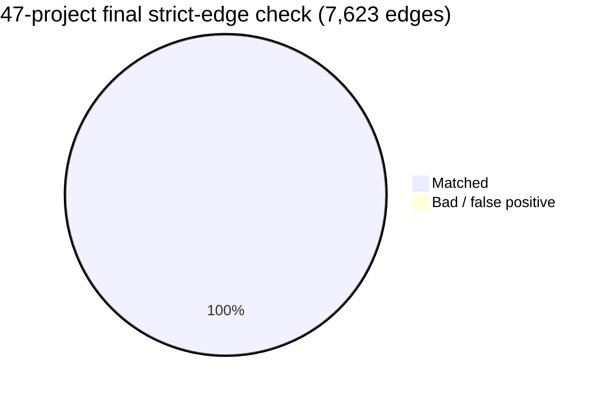
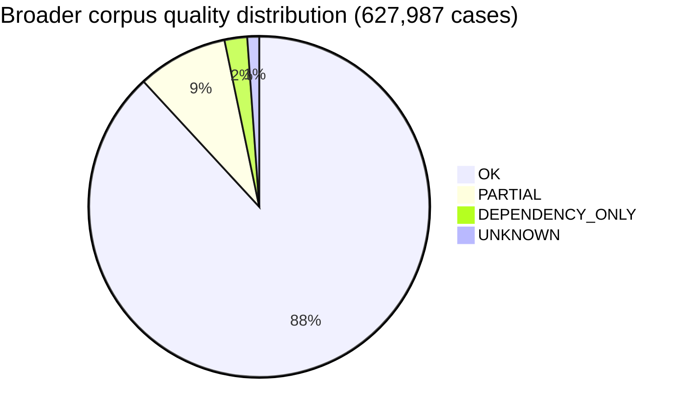
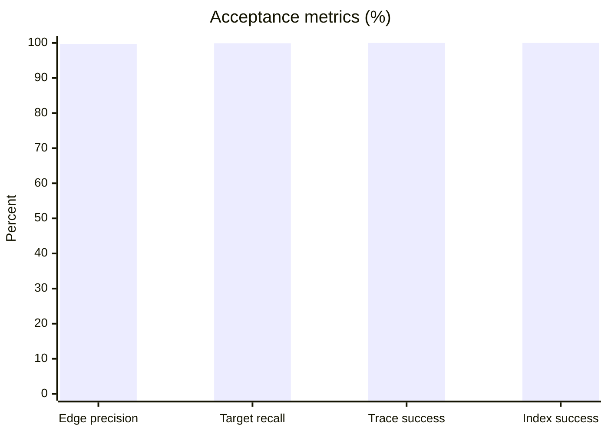
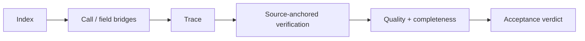

<div align="center">

# field-trace-graph

[English](README.md) | [简体中文](README.zh-CN.md)

**Trace any Java field back to where it comes from — one command, fully local.**

`ftg` builds a field-level lineage graph of a local Java project and answers
"where does this value come from, and where does it flow to?" — no server, no
upload, no model, no background process.

[](https://www.npmjs.com/package/field-trace-graph)
[](https://opensource.org/licenses/Apache-2.0)
[](https://nodejs.org/)
[](#supported-platforms)

```bash
npm install -g field-trace-graph && ftg --version
```

[Get Started](#get-started) · [Key features](#key-features) · [Commands](#command-reference) · [Troubleshooting](#troubleshooting)

</div>

## Contents

- [Get Started](#get-started)
- [Why field-trace-graph?](#why-field-trace-graph)
- [Key features](#key-features)
- [Supported platforms](#supported-platforms)
- [Command Reference](#command-reference)
- [Environment Variables](#environment-variables)
- [Semantic analysis and isolation](#semantic-analysis-and-isolation)
- [Generic types and framework adapters](#generic-types-and-framework-adapters)
- [Project detection and language level](#project-detection-and-language-level)
- [Field-lineage semantic contract](#field-lineage-semantic-contract)
- [External classpath](#external-classpath)
- [Index location](#index-location)
- [Output](#output)
- [Troubleshooting](#troubleshooting)
- [Development](#development)
- [Release](#release)
- [License](#license)

## Get Started

### 1. Install

```bash
npm install -g field-trace-graph
```

Node.js 18 or newer; no JDK is required, each release bundles its own runtime.
The package installs two names for the same command, `field-trace-graph` and the
short `ftg` — the examples below use `ftg`.

On first run — including a bare `ftg --version`, because the launcher needs the
release before it can forward anything — the launcher resolves the archive for
your OS/CPU from the bundled release manifest, verifies its SHA-256, extracts it
under `~/.field-trace-graph/dist/<version>`, and forwards arguments, signals,
and exit codes to that executable. The first download is about 200 MB; later
runs reuse the cache and start in under a second.
```bash
# Pin a version (what CI should do), or upgrade and remove.
npm install -g field-trace-graph
npm install -g field-trace-graph@latest
npm uninstall -g field-trace-graph

# Drop downloaded archives and runtimes; they are fetched again on demand.
rm -rf ~/.field-trace-graph/dist
```

<details>
<summary><b>Without npm — platform archive or a local JAR</b></summary>

Air-gapped machines and release debugging can skip the launcher entirely:

```bash
# Published archive: no JDK and no Node.js are needed after extraction.
tar -xzf field-trace-graph-0.1.0-linux-x64.tar.gz
./bin/ftg --version

# Or build the shaded JAR and run it with a local JDK (see Development).
java -jar lineage-cli/target/field-trace-graph.jar --version
```

</details>

### 2. Index a project

```bash
cd your-java-project
ftg init
```

`init` builds the complete graph in one pass and writes it to
`.field-trace-graph/trace.db` inside the project. It never uploads source code.

### 3. Trace a field

Run the commands from the Java project being analyzed. If the current directory
is not the project root, pass `--project /path/to/project`.

```bash
# Find a method. The output contains the signature to copy into the next command.
ftg methods --name OrderService

# Inspect the value targets in a method.
ftg targets --method 'com.example.OrderService#create(String,String)'

# Trace a specific value target in both directions.
ftg trace \
  --method 'com.example.OrderService#create(String,String)' \
  --target result.status \
  --direction both

# Include callers when investigating how the field reaches invoking code.
ftg trace \
  --method 'com.example.OrderService#create(String,String)' \
  --target result.status \
  --direction both \
  --call-scope full
```

Every command prints text by default; add `--format json` for a single JSON
object on stdout. Progress and logs always go to stderr.

## Why field-trace-graph?

Grep tells you where a name appears. It does not tell you how a value actually
reaches a field — through getters and setters, builders, BeanCopy, MapStruct,
streams, MyBatis parameter bridging, or a helper two calls away. Reconstructing
that by hand means opening file after file and re-deriving the same paths every
time.

`ftg` builds the graph once and answers directly: given a method and a target
expression, it returns the field-level edges in both directions, each carrying
the file and line that produced it, plus an explicit boundary when resolution
stops. Every hop is either evidence-backed (`EXACT_STATIC`) or clearly marked as
a candidate, so you can see why a conclusion was reached instead of trusting a
black box.

Everything runs locally against a SQLite index in the project — no server, no
network call, no source upload.

## Key features

| | |
|---|---|
| **Field-level lineage** | Traces individual fields and access paths (`result.status`, `goodTabCoupons[*].coupons`), not just method calls |
| **Bidirectional** | `--direction in` asks who writes a value, `out` asks where it flows, `both` joins the two at the target |
| **Evidence per edge** | Every edge records `fileId`, line/column range, resolution kind, and provenance; `ftg source` reprints the exact lines |
| **Explicit boundaries** | Unresolved flows end at a named reason (`CLASSPATH_MISSING`, `GENERATED_CODE_MISSING`, `RPC_BOUNDARY`, …) with a suggested next action instead of a silent gap |
| **Quality gates for CI** | `--fail-on-candidate`, `--fail-on-reason`, `--fail-on-boundary-density`, `--max-weak-hops` return exit code `6` when the graph is too weak |
| **Stable JSON output** | `--format json` emits one versioned object on stdout; logs and progress always go to stderr |
| **Framework-aware** | JavaParser-based extraction covers streams, builders, BeanCopy, MapStruct, Lombok-generated members, MyBatis Mapper XML, and constructor/super bindings |
| **100% local** | SQLite index in `.field-trace-graph/trace.db`; nothing leaves the machine |

## Supported platforms

| Platform | Architecture | Archive |
|---|---|---|
| macOS | arm64 | `field-trace-graph-<version>-darwin-arm64.tar.gz` |
| macOS | x64 | `field-trace-graph-<version>-darwin-x64.tar.gz` |
| Linux | x64 | `field-trace-graph-<version>-linux-x64.tar.gz` |
| Windows | x64 | `field-trace-graph-<version>-win32-x64.zip` |

Each archive bundles a JDK 17 runtime, so end users install no JDK.

## Command Reference

All normal commands accept `--project PATH` unless noted. The default project
root is detected from the current directory by walking up to the nearest Git
worktree, `pom.xml`, `build.gradle`, or `build.gradle.kts`.

### Common behavior

- `--format text` is the default. `--format json` emits one JSON object on
  standard output. Logs and progress use standard error.
- `--language-level N` overrides the language level detected from each module.
- `--include-tests` includes test source roots. Tests are excluded by default.
- `methods`, `targets`, and `trace` normally synchronize the local index before
  querying it. `--no-sync` reads the existing graph without updating it.
- `trace --allow-stale` permits reading the previous published generation when a
  refresh fails.
- `init` and `index` use `.field-trace-graph/index.lock` to serialize writers.
- `--generated-sources PATH` adds explicit annotation-processor or generated
  source roots. The option is repeatable or comma-separated and never guesses a
  build layout. Edges whose evidence file is under one of these roots are
  published with `provenance=GENERATED_SOURCE`.
- `--classpath PATH` adds an explicit JAR or class directory. It is repeatable
  or comma-separated, participates in the index context fingerprint, and is
  never inferred from `target/classes`. Class-file metadata is read without
  loading or executing dependency code.
- `--classpath-file PATH` reads classpath entries from a file produced by
  `mvn dependency:build-classpath` or a Gradle task. Entries may be one per
  line or separated by `:`/`;`; relative entries resolve against the file's
  directory. The file is merged with repeated `--classpath` options.

### Evidence and quality

Each logical edge has an independent `resolution` and `provenance`:

```text
resolution: EXACT_STATIC / CANDIDATE / UNRESOLVED / RUNTIME_OBSERVED
provenance: SOURCE / GENERATED_SOURCE / BYTECODE / FRAMEWORK_ADAPTER /
            RUNTIME_TRACE / MANUAL_CONTRACT
```

`edge_evidence` stores all evidence rows for a logical edge. Static source,
framework adapters, generated source, and future runtime imports therefore
accumulate instead of overwriting one another. `trace --format json` exposes
the selected top-level `resolution`/`provenance` and the complete `evidence[]`
array on each edge.

Open boundaries are not treated as silent failure. Every boundary reports
`reasonCode`, `recoverable`, `suggestedAction`, and `evidenceSource`. Weak hops
and ambiguous overload candidates use the same fields. Typical actions are
`run mvn generate-sources`, `provide --generated-sources`,
`provide-classpath`, `import-runtime-trace`, or `import-runtime-sql`.

Boundary reasons are deliberately specific so the next evidence step is
obvious:

| `reasonCode` | Meaning | First action |
| --- | --- | --- |
| `CLASSPATH_MISSING` | The receiver type is named by source/imports but no supplied classpath entry confirms its members. | `provide --classpath` |
| `GENERATED_CODE_MISSING` | The member is synthetic or processor-generated (Lombok, enum `values`/`valueOf`). | `provide --generated-sources` or rebuild with generated sources |
| `CALLEE_SYMBOL_MISSING` | The owner type is in source but the referenced member is absent and not known to be generated. | reindex with generated sources or supply the owning module/classpath |
| `RECEIVER_TYPE_UNKNOWN` | The receiver expression itself cannot be typed, typically a chain rooted in an unresolved value. | trace the receiver expression or import a runtime trace |
| `RPC_BOUNDARY` | A Dubbo/gRPC/Thrift/CXF/Feign/JAX-WS-style remote call boundary. | provide a contract or import runtime evidence |
| `SERIALIZATION_BOUNDARY` | Fastjson/Jackson/Gson-style serializer or deserializer call. | import runtime evidence or add a contract |
| `RPC_SERIALIZATION` | Legacy combined code found in indexes built before the split. | reindex to obtain the specific code |
| `EXTERNAL_LIBRARY` | Class-file metadata confirms the external member. | trace into it with runtime evidence if field lineage matters |
| `PLATFORM_LIBRARY` | JDK/platform call. It is closed by default and does not count toward unknown-boundary density. | none |
| `OVERLOAD_AMBIGUOUS` | Several same-arity targets remain after type narrowing. | disambiguate with types or provide the owning classpath |

`EXTERNAL` remains only as a legacy fallback for calls whose receiver type
cannot even be named. New indexes should not accumulate it in normal use; the
specific reason is what quality reports and contracts should consume.

### Explicit project contracts

FTG never reads `application.yml` to infer lineage. A project may instead add
`.field-trace-graph/contracts.yml`:

```yaml
version: 1
generatedSources:
  - target/generated-sources/annotations
contracts:
  - from: source.orderStatus
    to: RETURN.status
    reason: "MapStruct qualifiedByName converter"
    owner: "order-team"
    expiresWhen: "Source.orderStatus is removed"
    confidence: EXACT_STATIC
```

Generated-source entries are treated exactly like repeated
`--generated-sources` options. A contract must contain `from`, `to`, `owner`,
`reason`, and `expiresWhen`; otherwise it is ignored with a warning. When
`expiresWhen` contains a calendar date (`YYYY-MM-DD`), an expired contract is
skipped with a warning. `trace --strict-contracts` turns an incomplete,
expired, or unmatched contract into a hard failure. FTG matches
the contract against a shortest discovered evidence path, so the approved
endpoints may be separated by an intermediate setter or assignment. Every
matched path edge receives an additive `MANUAL_CONTRACT` evidence row; source
evidence is never removed.

### Runtime evidence import

Runtime capture imports observations without rewriting the static graph:

```bash
field-trace-graph evidence import \
  --file runtime-evidence.json \
  --format json
```

```json
{
  "schemaVersion": 1,
  "evidence": [
    {
      "logicalEdgeKey": "... copy from trace edges[].evidence[].logicalEdgeKey ...",
      "evidenceKind": "METHOD_ARGUMENT",
      "adapter": "opentelemetry",
      "rule": "observed by checkout integration test",
      "coverage": "one execution of checkout-e2e",
      "observedAt": "2026-11-09T00:00:00Z",
      "details": {"traceId": "..."}
    }
  ]
}
```

Imported rows use `resolution=RUNTIME_OBSERVED` and
`provenance=RUNTIME_TRACE`. `coverage` is mandatory because a runtime hit
proves only the observed execution path, not every branch. The original static
or adapter evidence remains in `edge_evidence` and in the trace `evidence[]`
array.

The same command auto-detects OpenTelemetry OTLP JSON and JFR JSON exports.
Carry `ftg.logicalEdgeKey` and `ftg.coverage` as span attributes (directly, in
an OTLP `attributes` array, or in a JFR `values` object). Optional attributes
are `ftg.scopeSymbolId`, `ftg.evidenceId`, `ftg.sourceEdgeId`,
`ftg.evidenceKind`, `ftg.adapter`, and `ftg.rule`. `startTimeUnixNano` is
converted to `observedAt`. Attributes without `ftg.logicalEdgeKey` are ignored
rather than guessed.

Compare captured keys with the current static graph before importing:

```bash
field-trace-graph evidence diff \
  --file runtime-evidence.json \
  --fail-on-missing \
  --format json
```

`evidence diff` reports `observedCount`, `matchedCount`, `missingCount`, and
`matchRatio`. A missing key means the runtime capture and the published graph
disagree; it is not used to invent an edge. `--fail-on-missing` returns exit
code `3` with diagnostic `RUNTIME_EVIDENCE_DRIFT`, which makes it suitable for
CI drift checks.

### `field-trace-graph` and `--help`

```bash
field-trace-graph
field-trace-graph --help
field-trace-graph --version
```

With no subcommand, the command prints the application banner. `--help` prints
the top-level command list. `--version` prints the application and schema
version. These are useful for checking which binary is installed.

### `init`

```bash
field-trace-graph init [OPTIONS]
```

Initializes the project and performs a full local index. It creates
`.field-trace-graph/trace.db`, analyzes Java source and semantic calls, and
publishes the initial graph generation. The result can be `PARTIAL` when
semantic diagnostics remain. Run it once for a new checkout; use `index` for
later refreshes.

| Option | Default | Effect |
|---|---:|---|
| `--project PATH` | Current detected root | Project directory to index. |
| `--format text / json` | `text` | Result output format. |
| `--lock-timeout SECONDS` | `30` | How long to wait for the project write lock. |
| `--index-timeout SECONDS` | `300` | Maximum time allowed for the initial index. |
| `--language-level N` | Auto-detected | Force one Java language level for the analysis. |
| `--include-tests` | `false` | Index test source roots as well as main sources. |
| `--generated-sources PATH` | None | Explicit generated-source root; repeat or comma-separate. |
| `--classpath PATH` | None | Explicit JAR or class directory; repeat or comma-separate. |

### `index`

```bash
field-trace-graph index [OPTIONS]
```

Builds or refreshes the local graph. Without `--full`, the command is normally
incremental. Use `--full` when a complete rebuild is required, for example after
changing parser rules or compilation context.

| Option | Default | Effect |
|---|---:|---|
| `--project PATH` | Current detected root | Project directory to index. |
| `--full` | `false` | Force a full rebuild instead of an incremental update. |
| `--format text / json` | `text` | Result output format. |
| `--lock-timeout SECONDS` | `30` | How long to wait for the project write lock. |
| `--index-timeout SECONDS` | `300` | Maximum time allowed for one index attempt. |
| `--language-level N` | Auto-detected | Force one Java language level for the analysis. |
| `--include-tests` | `false` | Index test source roots as well as main sources. |
| `--generated-sources PATH` | None | Explicit generated-source root; repeat or comma-separate. |
| `--classpath PATH` | None | Explicit JAR or class directory; repeat or comma-separate. |

### `status`

```bash
field-trace-graph status [OPTIONS]
```

Reads the published index state without writing to the graph. The text output
shows generation, graph status, freshness, file/symbol/node/edge counts, and the
last failed attempt when one exists. Use this to verify that `init` or `index`
published what you expected.

| Option | Default | Effect |
|---|---:|---|
| `--project PATH` | Current detected root | Project whose index is inspected. |
| `--format text / json` | `text` | Result output format. |
| `--language-level N` | Auto-detected | Override language level used for the status check. |
| `--include-tests` | `false` | Use the test-inclusive source scope. |
| `--generated-sources PATH` | None | Explicit generated-source root used for freshness checks. |
| `--classpath PATH` | None | Explicit JAR or class directory used for freshness checks. |
| `--classpath-file PATH` | None | Classpath file merged into the freshness context. |
| `--quality` | `false` | Include exact/candidate/unresolved ratios, open boundaries, density per 1000 methods, and top boundary reasons. |
| `--fail-on-boundary-density N` | None | Return exit code `6` when open boundaries per 1000 methods exceed `N`. |
| `--fail-on-reason CODE` | None | Return exit code `6` when the canonical boundary reason is present; repeat or comma-separate. |

`openBoundaryCount` and `openBoundaryDensityPer1000Methods` exclude
`PLATFORM_LIBRARY` calls such as `String.valueOf` or `Long.parseLong`. Those are
known JDK boundaries, not unknown project evidence; they remain visible in
`trace` boundaries and weak hops.

`frameworkAdapterEdgeCount` / `frameworkAdapterRatio` separate candidates
produced deliberately by adapters (MapStruct, MyBatis, Jackson/Fastjson field
serialization) from genuinely ambiguous candidates. Use
`ambiguousCandidateEdgeCount()` / `ambiguousCandidateRatio()` when a release
gate should ignore additive adapter evidence.

Text output separates the symbol count into comparable buckets:

```text
types=... methods=... businessMethods=... accessors=... constructors=... initializers=...
```

`methods` includes declared business methods, accessors, and synthetic
initializers. `businessMethods` is the default `methods` search scope.
`accessors` counts getters and setters without removing their field-flow
evidence from the graph.

### `methods`

```bash
field-trace-graph methods --name NAME [OPTIONS]
```

Searches class, method, and constructor candidates by a name fragment. Text
output prints complete method signatures without internal IDs. Copy a signature
directly into `targets --method` or `trace --method`.

| Option | Default | Effect |
|---|---:|---|
| `--name NAME` | Required | Class or method name fragment. |
| `--project PATH` | Current detected root | Project to search. |
| `--format text / json` | `text` | Result output format. |
| `--offset N` | `0` | Number of matching candidates to skip. |
| `--limit N` | `30` | Maximum number of candidates to print. |
| `--no-sync` | `false` | Do not refresh the index before searching. |
| `--language-level N` | Auto-detected | Override language level if a refresh is needed. |
| `--include-tests` | `false` | Search test source roots as well as main sources. |
| `--include-accessors` | `false` | Include getter/setter symbols in search results. |
| `--classpath PATH` | None | Explicit JAR or class directory used if a refresh is needed. |

### `targets`

```bash
field-trace-graph targets --method SIGNATURE [OPTIONS]
```

Lists value expressions that can be passed to `trace --target`, together with
their kind and source location. The list includes method-scope values and
evidence-backed field paths discovered in callees, so a parameter such as
`orderRequest` also exposes `orderRequest.addressId`,
`orderRequest.originId`, and the other fields that actually participate in
lineage. The method selector should normally be the full signature printed by
`methods`; a stable method ID is also accepted for automation.

The summary separates field lineage from call-expression bookkeeping:

```text
Targets: 45 (comparable=37 fields=29 roots=7 returns=1 calls=8)
```

`comparable` is `fields + roots + returns`. `calls` contains
`CALL_RESULT`/`CONSTRUCTOR_RESULT` targets such as
`call:queryByOrderId(1)`; they remain selectable but must not be counted as
object or field lineage when comparing graph implementations.

| Option | Default | Effect |
|---|---:|---|
| `--method SIGNATURE` | Required | Method signature or stable method ID. |
| `--project PATH` | Current detected root | Project to query. |
| `--format text / json` | `text` | Result output format. |
| `--offset N` | `0` | Number of matching targets to skip. |
| `--limit N` | `30` | Maximum number of targets to print. |
| `--no-sync` | `false` | Do not refresh the index before querying. |
| `--language-level N` | Auto-detected | Override language level if a refresh is needed. |
| `--include-tests` | `false` | Search test source roots as well as main sources. |
| `--classpath PATH` | None | Explicit JAR or class directory used if a refresh is needed. |

### `trace`

```bash
field-trace-graph trace \
  --method SIGNATURE \
  --target EXPRESSION \
  [OPTIONS]
```

Traces where a selected value or field comes from and where it flows. An object
target is evaluated as the union of its evidence-backed field traces, which
keeps object-level queries close to the real field lineage instead of walking
into every downstream object. Text output contains nodes, ordered chains,
data/call edges, boundaries, leaves, ambiguous overload candidates, weak hops,
and source evidence. Internal `PHI`/branch versions are kept in JSON but folded
out of the primary node list.

By default, `--call-scope effective` limits the loaded lineage to the selected
method and its callees. This keeps a field query focused on the field's real
producers and consumers instead of expanding through every unrelated caller.
Use `--call-scope full` only when diagnosing how a field reaches invoking code;
it also loads callers and may hit depth or edge limits on large call graphs.

`leaves` are the directional stopping points. `weakHops` are source-visible
calls that could not be bridged into analysed source, such as JDK or external
services. Only weak hops that touch the traced value or its scope are reported;
an unrelated call elsewhere in the same method does not degrade the field
result. They remain explicit boundaries, but they are not treated as proof that
the field is fully traced: `completeness` reports `PARTIAL` whenever a relevant
weak hop exists. This separates edge quality (`quality`, which only
looks at emitted field-value edges) from connectivity completeness. Boundaries
and leaves carry `evidenceId`, `sourceFile`, and
structured line/column ranges; weak hops carry `callSiteId`, `sourceFile`,
structured line/column ranges, `resolution=UNRESOLVED`, `reasonCode`,
`recoverable`, `suggestedAction`, and `evidenceSource`. An external call is
named with its declaring type, for example
`com.example.RemoteApi#fetch(java.lang.String)`, so it can be supplied to a
contract or runtime capture. `RPC_BOUNDARY` means a class-file or framework
annotation identified a remote call; `SERIALIZATION_BOUNDARY` means a
Fastjson/Jackson/Gson-style serializer or deserializer was called;
`CLASSPATH_MISSING` means the compiler saw the symbol but the supplied
classpath did not contain it. MyBatis SQL boundaries point at the mapper XML
file and bind expression, not at the mapper interface line.
`snapshotConsistent` confirms that every edge resolved to evidence
from the same published index generation. `fileIndexes` is the deduplicated
file-level evidence index for the trace. `evidenceIssues` reports missing or
hash-less evidence, and `noMatchReason` distinguishes a valid target with no
data edges from a field that does not exist.

Each edge also carries `operation`, `depth`, `resolved`, `bridged`, `srcScope`,
`dstScope`, `sourceFile`, `lineStart`, `lineEnd`, `argIndex`, and `argLevel`.
`operation` is the stored source expression when one is available; otherwise it
is a readable label for the edge type, so JSON consumers never need to infer a
step from a raw ID. Call-result producer hops use `CALL_PRODUCER` and expose the
receiver-to-result relationship, including external calls such as
`paymentService.fetchMerchantConfig(...)`.

Text output appends `at=<File.java>:<line>` to an edge whenever the statement
that produced it sits on a different line than the destination node's version
anchor. Whole-object copies (`COPY_ALL`), container element aggregates
(`list[*]`) and callee-effect bridges keep their version anchor on the receiving
variable, which is usually a declaration; `at=` names the exact copy, `add`/`put`
or call line, so a reader can confirm both the value version and the operation
that moved it. JSON already exposes the same position as `sourceFile` plus
`lineStart`.

For a field projected out of a container element (`list[*].field`), the
`effect=` anchor follows the selected field node, not the element allocation.
For example `msgList.add(dto)` reports `dto.setOwnerId(...)` as the effect when
`dto.ownerId` is the selected field; only an element built outside the analysed
source falls back to the insertion line.

The `Evidence:` block prints `<path>:<line>:<column>:<endColumn>` followed by
the exact source text at that position. Multi-line statements are collapsed to
single spaces so the snippet stays comparable, and a callee-effect bridge adds a
separate `effect=<File.java>:<line>` column instead of modifying the snippet;
the printed expression therefore always reproduces the cited source text.

Every edge also carries `category`:

- `FIELD_VALUE`: field or value lineage.
- `CALL_STRUCTURE`: call producer hops such as `CALL_PRODUCER`.
- `DEPENDENCY`: explicit control/call-input dependency edges included by
  `--include-dependencies`.
- `DIAGNOSTIC`: explanatory boundary or structure edges that do not
  participate in field-value quality.

`quality` is evaluated against field-value edges only. `structureEdges`,
`structureUnresolvedEdges`, and `structureStatus` report call producer gaps
separately; `diagnosticEdges`, `diagnosticUnresolvedEdges`, and
`diagnosticStatus` do the same for explanatory boundaries. Unresolved
structural or diagnostic edges stay visible without making complete field
lineage look incomplete. Only actual depth, edge, target-seed, or time limits
set `truncated`. Object target expansion is evaluated under the same query
deadline as traversal.

`chains[]` is a complete presentation projection over the authoritative
`edges[]`. Every chain has `edgeIds` and `hops[]`; each hop contains `edgeId`,
`srcNodeId`, `dstNodeId`, `edgeType`, `operation`, `resolution`, `resolved`,
`bridged`, `direction`, `sourceFile`, `lineStart`, and `lineEnd`. A chain can be
rendered without joining its edge IDs back to the edge collection. Text output
shows `hops=N` for each displayed chain.

`truncated` and `truncationReasons` describe deliberately bounded output.
`cycleDetected` means the complete deduplicated edge set contains a directed
cycle; it is a diagnostic and is not itself a truncation. There is no fixed
chain-count projection limit, and text output prints every chain and every weak
hop instead of a first-ten sample. `truncationReasons` can include `DEPTH_LIMIT`,
`EDGE_LIMIT`, `SEED_LIMIT`, and `TIME_LIMIT`. Edge and depth limits remain
explicit request options so callers can bound very large diagnostic queries
without silently shortening the default field-lineage result. `-1` is the only
automatic budget value; `0` and other negative values are rejected.

`completeness` is the user-facing connectivity verdict. `COMPLETE` requires
resolved field-value edges, no candidate evidence, no truncation, consistent
snapshot evidence, and no relevant weak hop or `USE_UNRESOLVED` boundary.
`PARTIAL` means the emitted edges are usable but a visible consumer could not be
followed. `INSUFFICIENT`, `UNKNOWN`, and `INCOMPLETE` keep the quality-gate
meanings described below. JSON output exposes the same value and its reasons.

A terminal boundary distinguishes three different states:

- `USE_UNRESOLVED`: a consumer call exists in source, but its body could not be
  analysed. This is a bridge gap, not "unused".
- `CONSUMED_BY_CALL`: the value is passed to a call whose result does not expose
  the field (typically a `void` method). The consumer is real.
- `NO_USE` / `NO_CONSUMER`: no outgoing evidence and no consuming call site in
  the analysed source. In text output this is explicitly labelled
  `NO_CONSUMER`; it means "no consumer found in analysed code", not a claim
  about runtime business behaviour.

A dotted target is accepted only when an analysed scope contains an
evidence-backed field with exactly that root and access path; otherwise `trace`
returns `NO_MATCH` with `FIELD_NOT_FOUND` instead of inventing a path. Text
output identifies methods by complete signatures and values by expressions;
stable IDs are present only in JSON for machine joins.

Exit status follows the connectivity verdict: `COMPLETE` is `0`; a `PARTIAL` or
`INSUFFICIENT` completeness result is the stale/incomplete code `3`. The
`--max-weak-hops N` option remains a stricter explicit gate and returns `6`
when its budget is exceeded. Use `--allow-resolution candidate` only when
candidate evidence is acceptable for the run; it does not hide weak hops or
unbridged consumers.

| Option | Default | Effect |
|---|---:|---|
| `--method SIGNATURE` | Required | Method signature or stable method ID. |
| `--target EXPRESSION` | Required | Target from `targets`, such as `result.status`. |
| `--direction in / out / both` | `both` | Trace upstream, downstream, or both directions. |
| `--call-scope effective / full` | `effective` | Follow the selected method and callees, or also include callers. |
| `--include-dependencies` | `false` | Include control, call-input, and mutation-effect dependency edges. |
| `--project PATH` | Current detected root | Project to query. |
| `--format text / json` | `text` | Result output format. |
| `--no-sync` | `false` | Do not refresh the index before tracing. |
| `--allow-stale` | `false` | Read the previous generation if a refresh fails. |
| `--max-depth N` | Auto | Maximum traversal depth; `-1` selects 30 for field targets and 100 for object targets. `0` is invalid. |
| `--max-edges N` | Auto | Maximum number of traversed edges; `-1` selects 2500 for field targets and 5000 for object targets. `0` is invalid. |
| `--query-timeout SECONDS` | `0` | Maximum query time; `0` disables the limit. |
| `--language-level N` | Auto-detected | Override language level if a refresh is needed. |
| `--include-tests` | `false` | Include test source roots in the analysis. |
| `--generated-sources PATH` | None | Explicit generated-source root used for refresh and freshness checks. |
| `--classpath PATH` | None | Explicit JAR or class directory used for refresh, class-file metadata, and freshness checks. |
| `--classpath-file PATH` | None | Classpath file used for refresh and freshness checks. |
| `--allow-resolution exact / candidate` | `exact` | Accept candidate edges as complete output. Unresolved evidence still fails. |
| `--fail-on-candidate` | `false` | Return a non-zero exit code whenever candidate evidence is present, even with `--allow-resolution candidate`. |
| `--max-weak-hops N` | `-1` | Return exit code `6` when the trace exposes more weak hops than `N`; `-1` disables the gate. |
| `--strict-contracts` | `false` | Fail on incomplete, expired, or unmatched `.field-trace-graph/contracts.yml` entries. |

### `source`

```bash
field-trace-graph source \
  --file src/main/java/Example.java \
  [--start 1] [--end 20] \
  [OPTIONS]
```

Reads a bounded source excerpt for evidence review. The file path is relative to
the project root. The default range is line 1 through line 20.

| Option | Default | Effect |
|---|---:|---|
| `--file PATH` | Required | Relative source file path. |
| `--start N` | `1` | First line to read. |
| `--end N` | `20` | Last line to read. |
| `--project PATH` | Current detected root | Project containing the file. |
| `--format text / json` | `text` | Result output format. |
| `--language-level N` | Auto-detected | Override language level for the source scope. |
| `--include-tests` | `false` | Allow a file under a test source root. |

### `doctor`

```bash
field-trace-graph doctor [OPTIONS]
```

Checks the local runtime environment. It reports the Java version, whether a
compiler is available, whether SQLite JDBC is available, OS/architecture, and
whether the project index file exists. It does not create or update an index.

| Option | Default | Effect |
|---|---:|---|
| `--project PATH` | Current detected root | Project whose index presence is checked. |
| `--format text / json` | `text` | Result output format. |

## Environment Variables

Runtime size and timeout budgets can be overridden without editing the
properties file:

| Variable | Purpose |
|---|---|
| `FIELD_TRACE_GRAPH_PARSER_VERSION` | Override the parser/schema compatibility version. |
| `FIELD_TRACE_GRAPH_SOURCE_MAX_FILES` | Maximum source files in one scan. |
| `FIELD_TRACE_GRAPH_SOURCE_MAX_FILE_BYTES` | Maximum bytes per source file. |
| `FIELD_TRACE_GRAPH_SOURCE_MAX_TOTAL_BYTES` | Maximum total source bytes per scan. |
| `FIELD_TRACE_GRAPH_SOURCE_MAX_DEPTH` | Maximum source tree depth. |
| `FIELD_TRACE_GRAPH_INDEX_LOCK_TIMEOUT_MILLIS` | Default index lock wait in milliseconds. |
| `FIELD_TRACE_GRAPH_INDEX_TIMEOUT_MILLIS` | Default index timeout in milliseconds. |
| `FIELD_TRACE_GRAPH_QUERY_TIMEOUT_MILLIS` | Default trace query timeout in milliseconds. |
| `FIELD_TRACE_GRAPH_QUERY_MAX_DEPTH` | Default maximum traversal depth. |
| `FIELD_TRACE_GRAPH_QUERY_MAX_EDGES` | Default maximum traversal edges. |
| `FIELD_TRACE_GRAPH_QUERY_MAX_CALLEE_DEPTH` | Maximum callee expansion depth. |

Build and release variables include `JAVA_HOME`, `FTG_JAVA_HOME`,
`FTG_RUNTIME_HOME`, `FTG_BUNDLE_RUNTIME`, `FTG_STRICT_RELEASE`, `VERSION`, `OS`,
and `CPU`. `FTG_SKIP_BUILD=1` reuses an existing JAR during a release build;
`FTG_SKIP_SECURITY_SCAN=1` skips the security scan only when the caller has a
separate approved scan step.

## Semantic analysis and isolation

Compile-time diagnostics run in a separate `SemanticWorkerMain` subprocess launched
by `SemanticWorkerLauncher`. The worker is bounded by a timeout, heap limit, and
response size limit, and its private temp directory is always removed. Annotation
processors, implicit source discovery, and target project code are never executed.

## Generic types and framework adapters

Declared generic types are preserved for member resolution. A field or method
that returns `T` on `Wrapper<Order>` resolves to `Order`, and collection,
optional, future, and map reads resolve their element/key/value types instead
of erasing to `Object`. This is used by constructor, stream, BeanCopy, and
receiver-type decisions when the source declaration is available.

Implicit lambda parameters are typed from the collection, stream, optional or
map they iterate (`users.stream().map(user -> user.getName())` binds
`user` to the `List<User>` element). This keeps method dispatch inside lambda
bodies exact instead of degrading to an unknown-receiver boundary.

Bean serialization is a framework adapter: Fastjson `JSON.toJSONString`,
Jackson `writeValueAsString`, and Gson `toJson` expand declared fields into
field-to-result edges. Annotation-based exclusions such as `@JSONField(...,
serialize = false)` and `@JsonIgnore` are honoured. These edges are published
as `resolution=CANDIDATE` with `provenance=FRAMEWORK_ADAPTER`; import a runtime
trace to confirm the fields that were actually serialized. Serializer calls
nested inside logging or telemetry calls are ignored, so
`log.info("{}", JSON.toJSONString(bean))` does not create field-lineage edges.
Logging is detected from the receiver's declared `Logger`/`Log` type, the
common logging packages, and standard logger factory calls such as
`LoggerFactory.getLogger(...)`. Vendor-specific monitoring utilities are not
hard-coded as loggers; they remain ordinary call boundaries unless their
declared type proves they are a logger. Wrapper utilities whose receiver name
contains `Logger` and whose method name contains a log level (for example
`AuditLogger.reportError`) are still treated as diagnostic sinks.

Tuple factories are expanded by arity: Commons `Pair`/`Triple` expose
`left`/`middle`/`right`, JavaTuples expose `value0..N`, and Reactor/Vavr
`TupleN` expose both `tN` and `_N`. `Map.entry(k, v)` is modelled as
`key`/`value`. Collection factories such as `List.of`, `ImmutableList.of`,
`Lists.newArrayList`, and `Optional.of` keep element flow, while transparent
wrappers (`Objects.requireNonNull`, `Optional.orElse`, `StringUtils.defaultIfNull`)
preserve their inputs instead of becoming external boundaries.
Empty collection factories and collection/map constructors are excluded from
weak-hop accounting because they cannot consume a field value.

`Optional` and `CompletableFuture` are single-value wrappers. Callback methods
such as `map`, `flatMap`, `filter`, `thenApply`, `thenCompose`, and `handle`
are projected onto concrete field paths, including method references
(`Optional.map(Bean::getAddress)`). Terminal methods (`orElse`, `join`) and a
direct `return` keep the same field path, so `bean.address.city` can be
followed through the whole wrapper chain instead of stopping at the JDK call.
Common pure utility owners (`StringUtils`, `CollectionUtils`, `ObjectUtils`,
`NumberUtils`, `BooleanUtils`, `ArrayUtils`, `MapUtils`, `Objects`) are treated
as transparent conversions rather than unresolved external calls.

MyBatis mapper XML is discovered by namespace rather than a hard-coded
`/mapper/` directory. Bind variables retain XML line/column metadata;
`<sql>` fragments reached through `<include>` are expanded for parameter
discovery, and `<foreach>` item aliases are mapped back to their collection
parameter. SQL bind edges reuse the existing Java parameter/field value node
when one exists, so the SQL boundary stays connected to the Java lineage chain.
Legacy iBatis 2 `<sqlMap>` files are also recognized when their namespace maps
to a type annotated with `@Dao(value = "...")`; `parameterClass` and
`resultClass` are accepted as aliases for `parameterType` and `resultType`, and
`#param#` / `$param$` bind syntax is normalized to the same SQL boundary model.

## Project detection and language level

The project root is the nearest Git worktree, `pom.xml`, or `build.gradle` from the
current directory, unless `--project` is given. Each module's Java language level is
read statically from `pom.xml` (`release`, `maven.compiler.release`,
`maven.compiler.source`, `source`) or `build.gradle` (`options.release`,
`sourceCompatibility`). A module inherits compiler configuration from parent
directories up to the project root. Modules with no static level fall back to Java
17 and are marked as assumed.

## Field-lineage semantic contract

- `both` defaults to `effective` call scope: the selected method and its callees.
  Caller expansion requires `--call-scope full`.
- Field-value traversal uses assignments, field writes, return values, container
  copies, constructor/Builder/BeanCopy flows, and explicit call argument/return
  binding. `ARGUMENT_TO` is a call-boundary transport edge, not an
  `ASSIGNED_FROM` value-source claim.
- `CONDITION_USES` and `CALL_INPUT_USES` are dependency evidence, not field-value
  edges. They are excluded by default and appear only with
  `--include-dependencies`. Keeping `CONDITION_USES` for `if`, ternary,
  `switch`, and guard expressions is intentional: a condition controls which
  branch runs, not which value is produced, so it must not be promoted to a
  field-value edge.
- A virtual call declared on an interface or abstract class is bridged into
  every analysed source implementation, not just the first one. Each
  implementation edge is `CANDIDATE`; argument and return field bridges then
  continue inside each body. A single source implementation is
  `VIRTUAL_UNIQUE` and stays exact. This is the same dispatch rule used for
  generic Java interfaces and for RPC-style service interfaces. The interface
  may come from a dependency JAR; a source implementation is still bridged when
  its erased parameter types match the call.
- A setter that stores an object reference (`holder.setRequest(request)`) and a
  later getter (`holder.getRequest()`) form an object-valued property bridge.
  Fields read from the getter result continue as fields of that object, not as
  `holder.request.field`; `void` calls do not invent a field on their result.
- Logging, monitoring, and telemetry reads are not field lineage.
- Unknown external calls stop at `EXTERNAL_BOUNDARY`; they are never rewritten as
  confirmed field assignment edges.
- User-facing targets keep business fields primary. `RETURN` is `RETURN`, a
  constructor result is `CONSTRUCTOR_RESULT`, and an ordinary call result is
  `CALL_RESULT`. Getter/setter call syntax is normalized to its business field.
- `this.field`, a concrete variable field, and a constructor result field keep
  their owning scope. They share the same canonical field suffix, but fields from
  different receiver objects are not merged merely because their names match.
- Trace quality is deterministic and is calculated from field-value edges only.
  Candidate edges are reported separately from unresolved edges and make the
  result `PARTIAL` even when all candidate evidence is present. Unresolved value
  edges below 10% are `OK`; 10% to below 30%, or an actual truncation with
  unresolved value edges, is `PARTIAL`; 30% or more is `INSUFFICIENT`. A trace
  with no field-value evidence at all is `UNKNOWN`. A partial semantic index, an
  unresolved call-structure edge, or an unresolved diagnostic edge does not by
  itself downgrade complete field lineage. Those gaps remain visible in
  `structureStatus` and `diagnosticStatus`. Resolved edges remain available in
  every case.

## External classpath

Place an optional `.semantic-classpath.xml` at the project root. The canonical
format is shared with the semantic classpath indexer:

```xml
<?xml version="1.0" encoding="UTF-8"?>
<semanticClasspath version="1">
  <module path="order-service-common" sourceSet="main">
    <jar path="semantic-libs/commons-lang3-3.5.jar"
         sha256="64-lowercase-hex-characters"/>
  </module>
</semanticClasspath>
```

Paths are project-relative and each JAR hash is mandatory. The older
`<classpath><entry .../></classpath>` format remains readable for local
compatibility, but new files should use the canonical schema. The tool validates
each local JAR but never runs Maven, Gradle, annotation processors, or project
code, and never downloads dependencies. A missing manifest is allowed but
produces a `PARTIAL` graph when javac cannot resolve external types; an invalid
manifest is rejected instead of being silently ignored.

For a one-off build, pass the same entries explicitly:

```bash
field-trace-graph index \
  --classpath target/classes \
  --classpath ~/.m2/repository/com/example/api/1.0/api-1.0.jar
```

Directories and JARs are accepted. The tool reads class-file names, method
descriptors, and class-level annotations to distinguish `RPC_SERIALIZATION`,
`EXTERNAL_LIBRARY`, and `CLASSPATH_MISSING` without loading the class or running
its static initializer. `--classpath` is also part of the freshness fingerprint:
adding or removing an entry makes an existing index `STALE` until it is
rebuilt.

## Index location

The SQLite index is written to `.field-trace-graph/trace.db` inside the project root.
The tool does not modify source files.

## Output

Pass `--format json` for a single JSON object on stdout. Logs and progress go to
stderr. Exit codes: `0` success, `2` usage/not-found, `3` stale or missing index,
`4` internal/parse/storage error, `5` resource budget.

## Troubleshooting

**First run looks frozen** — it is downloading the platform archive (~200 MB).
This happens on the first invocation of any command, `--version` included.
The launcher writes `downloading <archive> (<size>)...` and
`downloaded <archive> (<size>) in Ns` to stderr; later runs start in under a
second.

**`init` hangs** — you are probably indexing a directory that is not a project
root (running it in `~` walks your entire home directory). Run it inside the
project, or pass `--project /path/to/project`.

**`ftg` and `field-trace-graph` behave differently** — they cannot: both are
symlinks to the same launcher. Run `type -a ftg`; an older shell alias will
shadow the installed command.

**Results look stale after editing code** — `init` and `index` refresh the
graph. Use `--no-sync` only when you deliberately want to read the existing
index.

**Getter/setter flows stop early on Lombok classes** — generated members are not
in the source. Produce delombok output and pass `--generated-sources <dir>` so
those accesses resolve.

**A trace ends at `CLASSPATH_MISSING`** — the receiver type is named in source
but no classpath entry confirms its members. Pass `--classpath` (or a
`--classpath-file`) pointing at the module's output directory or dependency JARs.

**`database is locked` or a corrupted cache** — remove
`~/.field-trace-graph/dist/` (launcher) and `.field-trace-graph/` (index); the
next run rebuilds both.

**Index is unexpectedly large** — check that `target/`, `build/`, and generated
directories are covered by `.gitignore`, and that generated source roots are
passed explicitly with `--generated-sources` instead of being indexed as regular
source.

## Development

### Requirements

- Published npm package: Node.js 18 or newer. No system JDK is required.
- Build from source: JDK 17 or 21 with `javac`, Maven, and Node.js 18 or newer.
- Release build: a redistributable JDK 17 or 21 selected with `FTG_RUNTIME_HOME`.

### Build

```bash
export JAVA_HOME=/path/to/jdk-17-or-21
mvn clean package
```

The shaded executable jar is `lineage-cli/target/field-trace-graph.jar`.

For a local JAR build, run it from any project root or pass `--project`:

```bash
cd /path/to/java-project
java -jar /path/to/field-trace-graph.jar init
java -jar /path/to/field-trace-graph.jar methods --name OrderService
java -jar /path/to/field-trace-graph.jar trace \
  --method 'com.example.OrderService#create(String,String)' \
  --target result.status
```

For shorter commands, create an alias in the current shell:

```bash
alias ftg='java -jar /path/to/field-trace-graph.jar'
ftg init
```

### Modules

- `lineage-core`: domain model, query rules, ports, and JDK-only shared utilities.
- `lineage-java`: Java AST extraction, type/call resolution, and semantic analysis.
- `lineage-storage-sqlite`: SQLite schema, SQL, row mapping, and transactions.
- `lineage-cli`: command controllers, application services, views, and assembly.
- `distribution/npm`: thin Node launcher for a global install.

### Development Commands

These commands operate on this repository, not on the Java project being
analyzed.

```bash
# Compile all modules and build the executable JAR.
mvn clean package
mvn -q clean package
```

This repository does not ship unit tests or a regression harness, so
`mvn test` has nothing to run. Build with `mvn clean package`.

If the local Maven cache was populated by a different Maven installation, or
the machine is offline, Maven may warn that an artifact was "cached from a
remote repository ID that is unavailable in current build context". The
artifacts are already present, so build offline or disable local-repository
tracking:

```bash
mvn -o clean package     # air-gapped build against a complete local cache
mvn -llr clean package   # legacy local repository, ignores cached repo IDs
```

The shaded executable is `lineage-cli/target/field-trace-graph.jar`. The
individual module JARs are build artifacts and are not the normal command-line
entry point.

### Diagnostic Commands

The local graph is SQLite and is safe to inspect directly. These commands are
read-only:

```bash
# List tables.
sqlite3 .field-trace-graph/trace.db ".tables"

# Show one published index state and table counts.
sqlite3 .field-trace-graph/trace.db <<'SQL'
SELECT 'files', COUNT(*) FROM source_file
UNION ALL SELECT 'symbols', COUNT(*) FROM source_code_symbol
UNION ALL SELECT 'nodes', COUNT(*) FROM value_node
UNION ALL SELECT 'edges', COUNT(*) FROM value_data_edge
UNION ALL SELECT 'call_edges', COUNT(*) FROM parsed_invoke_edge
UNION ALL SELECT 'method_summaries', COUNT(*) FROM method_summary
UNION ALL SELECT 'pending_refs', COUNT(*) FROM pending_parse_invoke_ref;

SELECT active_generation, graph_status, published_at,
       last_attempt_status, last_error_code
FROM full_index_state;
SQL
```

Useful checks:

- `files` should match the expected main Java source count when tests are
  excluded.
- `status` is the easiest way to check whether the latest generation is
  `READY`, `PARTIAL`, or stale.
- `doctor` distinguishes a missing runtime/compiler from a missing index.

#### Index counters and symbol dimensions

`ftg status` reports the counters below. They are the authoritative check that a
published generation covers the source tree you expect.

`parsed_invoke_edge` stores only calls that reached a callee (`EXACT_STATIC`,
`COMPILE_TIME_TARGET`, `VIRTUAL_UNIQUE`, `CANDIDATE`). Unresolved calls are
recorded once, in `pending_parse_invoke_ref`, together with the call-site payload
(dispatch kind, receiver, arguments, result value) needed to keep
receiver-to-result bridges during traversal. The two tables are therefore
disjoint and their counts can be compared with tools that separate pending
references. `ftg status` prints both numbers as `calls=` and `pending=`.

Symbol comparison uses separate dimensions instead of one `kind` column:

```text
declaration kind: CLASS / INTERFACE / ENUM / RECORD / ANNOTATION /
                  METHOD / CONSTRUCTOR / INITIALIZER
symbol role:      BUSINESS / ACCESSOR_GET / ACCESSOR_SET / INITIALIZER
```

Use these FTG counters for comparison:

```sql
SELECT
    COUNT(*) AS total_symbols,
    SUM(kind IN ('CLASS','INTERFACE','ENUM','RECORD','ANNOTATION')) AS type_count,
    SUM(kind = 'METHOD') AS method_count,
    SUM(kind = 'METHOD' AND symbol_role = 'BUSINESS') AS business_method_count,
    SUM(symbol_role IN ('ACCESSOR_GET','ACCESSOR_SET')) AS accessor_count,
    SUM(kind = 'CONSTRUCTOR') AS constructor_count,
    SUM(symbol_role = 'INITIALIZER') AS initializer_count
FROM source_code_symbol;
```

For a stable row-level key, use the declaration tuple rather than the numeric
symbol IDs:

```text
relative file path
+ declaring type fully-qualified name
+ method or constructor name
+ normalized parameter types
+ constructor flag
```

The branch and commit must match before interpreting a remaining difference as
a regression.

## Release

### Build A Release

Bump every version source with one command:

```bash
scripts/bump-version.sh 0.2.0
```

The Maven reactor keeps one version in the root POM's `<revision>` property; the
four module POMs inherit it. The script updates that property, both manifests
(`version`, the `baseUrl` release tag, and all four archive names), and the npm
package version, then validates the result. Hashes are reset to zeros because
new archives have not been built yet.

After the bump, only these three version-bearing locations need review: the root
POM `<revision>`, the root release manifest, and the npm package version. Archive
names and the npm manifest copy are derived, not hand-edited.

Build a local archive with a bundled runtime (the version defaults to the root
manifest; archives are named from it):

```bash
export FTG_RUNTIME_HOME=/path/to/redistributable-jdk-17-or-21
FTG_STRICT_RELEASE=1 OS=darwin CPU=arm64 distribution/build-release.sh
```

The archive contains `bin/`, `lib/`, `runtime/`, `licenses/`, the CycloneDX SBOM,
and `.version`. Its SHA-256 is written to `distribution/release-manifest.json`.
Set `FTG_BUNDLE_RUNTIME=0` only for local debugging; strict release builds require
the bundled runtime.

Run the fail-closed release gate before publishing:

```bash
FTG_VERIFY_PLATFORM_ONLY=darwin-arm64 distribution/verify-release.sh
```

`verify-release.sh` checks the license, npm license metadata, HTTPS download
base, archive hashes, archive layout, bundled runtime, runtime/third-party
licenses, SBOM, secret scan, and generated source/npm/archive SBOMs. See
`To-do/RELEASE-CHECKLIST.md` for the external ownership, hosting, and signing inputs
that cannot be inferred from source code.

### Release Commands

The release scripts are for maintainers and require the ownership, license,
hosting, and signing inputs listed in `To-do/RELEASE-CHECKLIST.md`.

```bash
# Build one platform archive with a bundled runtime.
export FTG_RUNTIME_HOME=/path/to/redistributable-jdk-17-or-21
FTG_STRICT_RELEASE=1 OS=darwin CPU=arm64 distribution/build-release.sh

# Run the fail-closed archive and manifest verification gate.
FTG_VERIFY_PLATFORM_ONLY=darwin-arm64 distribution/verify-release.sh

# Smoke-test the unpacked archive with its bundled runtime.
distribution/smoke-test-release.sh \
  distribution/build/field-trace-graph-*-darwin-arm64.tar.gz

# Build the npm tarball, install it into a temp prefix, and exercise the launcher.
distribution/smoke-test-npm.sh \
  distribution/build/field-trace-graph-*-darwin-arm64.tar.gz

# Run the source, npm tarball, and archive secret/SBOM scan.
distribution/security-scan.sh

# Build and smoke-test the npm launcher locally.
cd distribution/npm
npm pack
npm install -g ./field-trace-graph-*.tgz
field-trace-graph --version
field-trace-graph doctor
```

Internal release helpers:

```bash
# Copy the root release manifest into the npm package when packing.
node distribution/npm/scripts/sync-manifest.js

# Update one platform entry after an archive is built.
node distribution/update-release-manifest.js \
  darwin arm64 field-trace-graph-<version>-darwin-arm64.tar.gz "$SHA256"
```

The build script calls the manifest updater automatically. `npm pack` runs
`sync-manifest.js` through the package `prepack` script. `verify-release.sh`
calls `security-scan.sh` unless `FTG_SKIP_SECURITY_SCAN=1` is explicitly set.

## License

Apache License 2.0 — see [LICENSE](LICENSE).

<div align="center">

**Local Java field lineage — no server, no upload, no model.**

[Report a bug](https://github.com/rycan-top/field-trace-graph/issues) ·
[Request a feature](https://github.com/rycan-top/field-trace-graph/issues)

</div>


## Why FTG?

When an AI agent needs to understand a codebase, it usually discovers structure the
slow way: grep, glob, read, one file at a time, rebuilding field paths and call
chains by hand.

FTG hands the agent the field-level graph it needs in one query. It is a pre-built
local graph of symbols, field reads/writes, call edges and external boundaries:

- **Field-level, not just call-level.** It follows getters/setters, constructors,
  builders, streams, collections, bean copy, ORM mappings and RPC dispatches.
- **Dynamic dispatch is part of the graph.** An interface call can be bridged into
  every analysed implementation; the trace does not stop at the declaration.
- **Evidence is attached to every edge.** Source file, line/column, resolution
  strength, provenance and effect location are first-class output.
- **Uncertainty is explicit.** External calls, missing classpath, ambiguous
  overloads and condition-only consumption become named boundaries instead of
  silent gaps.
- **Local by default.** The index is a project-local SQLite database; no source
  upload and no external service are required.

The acceptance question is not "does it produce a graph?" but **"are the reported
fields and paths actually supported by source?"**

## Acceptance Criteria

| ID | Criterion | Target | Result |
|---|---|---|---|
| CR-1 | Build and release artifacts reproduce | jar + SBOM + archive | PASS |
| CR-2 | Index reliability on the full corpus | 100% READY | PASS (47/47) |
| CR-3 | Trace reliability on the full corpus | 100% success | PASS (4,749/4,749) |
| CR-4 | Strict edge precision vs source | >= 99.5% | PASS (99.63% first round, 100% final) |
| CR-5 | Field target recall | >= 99% | PASS (99.88%) |
| CR-6 | True false positives | 0 after fixes | PASS (2 found, root-caused and fixed) |
| CR-7 | Quality regression | 0 | PASS (0 precision regression) |
| CR-8 | Index cleanup safety | source untouched | PASS |
| CR-9 | Performance bounds | no unbounded trace | PASS |
| CR-10 | Boundary semantics | condition/external explicit | PASS |

## Benchmark Results

### 1. Field-lineage accuracy

First full-source verification round:

| Metric | Result |
|---|---:|
| Sampled method/target cases | 2,200 |
| Strict edges checked against source | 7,837 |
| Edge precision | **99.63%** |
| Target recall (value reads) | **99.88%** |
| Residuals | 28 |
| — anchor/path precision (value flow valid) | 26 |
| — true false positives | 2 (0.03%) |

The two true false positives were the same root cause: a `List<Element>` projected
to `List<String>` by `map(getId)` still carried an element field path. The fix
requires declared element types and container projection evidence; after the fix
the path was removed and the sample re-verified.

Second focused verification round after fixes:

| Metric | Result |
|---|---:|
| Strict edges checked | 862 |
| Hits | **862 (100%)** |
| Quality changes | 0 |

Final 47-project acceptance rescan:

| Metric | Result |
|---|---:|
| Projects | 47 |
| Method/target cases | 4,749 |
| Strict edges checked | 7,623 |
| Hits | **7,623 (100%)** |
| Bad edges / false positives | **0** |
| Trace failures | **0** |
| Quality fallbacks | 0 precision regressions |

### 2. Broader quality distribution

A 45-library batch over 627,987 method/target combinations:

| Quality state | Share |
|---|---:|
| OK | **88.14%** |
| PARTIAL | 8.59% |
| DEPENDENCY_ONLY (condition-only) | 2.15% |
| UNKNOWN | 1.13% |

A larger 18,070-Java-file corpus over 64,552 cases:

| Metric | Result |
|---|---:|
| Trace success | **100%** |
| Quality OK | 83.4% |
| Completeness COMPLETE | 42.2% |
| Completeness PARTIAL | 55.2% |
| Completeness UNKNOWN | 2.6% |
| Weak hops | 81,181 |

`UNKNOWN` here means no field-value evidence could be produced, not "field does
not exist"; most cases are external frameworks, dynamic boundaries or
condition-only use.

### 2.5 Reindex acceptance

Four previously unfinished or stale indexes were rebuilt from source and verified:

| Target | Files | Value nodes | Data edges | State |
|---|---:|---:|---:|---|
| Large multi-module project A | 2,887 | 749,520 | 564,247 | READY / FRESH |
| Mid-size project B | 2,316 | 320,825 | 241,400 | READY / FRESH |
| Small project C | 82 | 2,162 | 866 | READY / FRESH |
| Large project D | 6,276 | 1,139,427 | 868,341 | READY / FRESH |

All four had WAL = 0 and `quick_check = ok`. A 40-edge source-anchor sample
matched **40/40**, and the follow-up focused round matched **862/862**.

### 3. Scale and performance

| Change | Before | After |
|---|---:|---:|
| Redundant JOIN on a hot query | baseline | **3.3× faster** |
| Repeated trace cache path | baseline | **5.7× faster** |
| Pathological large call cone | unbounded / 600s CPU | **27s timeout** |
| Boundary projection on a pathological case | 168s | **10s** |
| 6,300-file index | previous limits | **~45.5 min**, 1.16M nodes / 890K edges |

The final gate did not observe a trace that could not finish; all timeouts are
explicit `TIME_LIMIT`/`DEPTH_LIMIT` boundaries with a reason code.

### 4. Index lifecycle and data safety

| Item | Result |
|---|---:|
| Stale/incomplete indexes removed | 54 |
| Space reclaimed | **21.93 GiB** |
| Source files deleted | **0** |
| Half-built indexes detected | 2 |
| Disk free after cleanup | 32 GiB → **63 GiB** |

Only `.field-trace-graph/` index files (`trace.db`, `-wal`, `-shm`, lock files)
were removed. Source, `classpath.txt`, release payloads and verification outputs
were preserved.

### 5. Fixes landed in the acceptance window

The audit fixed 58 findings. Grouped by impact:

| Group | Representative outcomes |
|---|---|
| Field-path resolution | nested object paths, lambda shadowing, stream element types, container element projection |
| Call bridging | virtual/RPC implementations, builder chains, method references, iBatis/MyBatis SQL bridges |
| Evidence precision | effect locations, constructor argument positions, multi-`return` anchors, element insertion anchors |
| Boundary semantics | condition-only consumption, external/platform boundaries, ambiguous methods |
| Performance | O(nodes × mutations) binder scans replaced by indexed lookup; deadline checks in storage scans |
| Index lifecycle | batched publish, WAL bounds, failure state visibility, stale-index cleanup |

## Charts









## Known Boundaries

These are explicit limits, not hidden failures:

- External method bodies and missing classpath remain `EXTERNAL_LIBRARY` /
  `CLASSPATH_MISSING`; import a classpath or runtime evidence to continue.
- Anonymous-class field identity and generated members may still stop at a
  generated-code boundary.
- Condition-only reads are `DEPENDENCY_ONLY`; they are intentionally excluded
  from value-flow precision.
- Ambiguous same-FQN methods across modules are reported with candidates; they
  are not silently guessed.
- Multi-return anchor precision and container scalar projection were found and
  fixed in this window; they remain regression cases.

## Verdict

**PASS**, with the boundaries above documented as expected behavior.

The strongest evidence is not the aggregate quality percentage; it is the
source-anchored audit: **7,623 of 7,623 checked strict edges matched source, with
0 bad edges, 0 trace failures and 0 precision regressions** in the final
47-project rescan.
