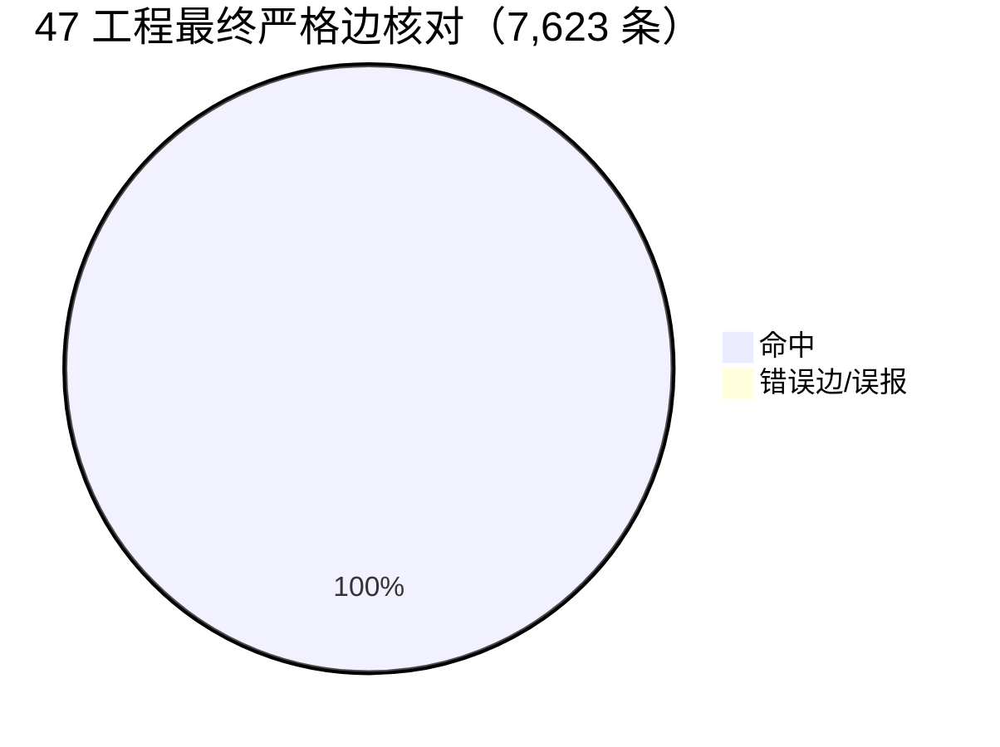
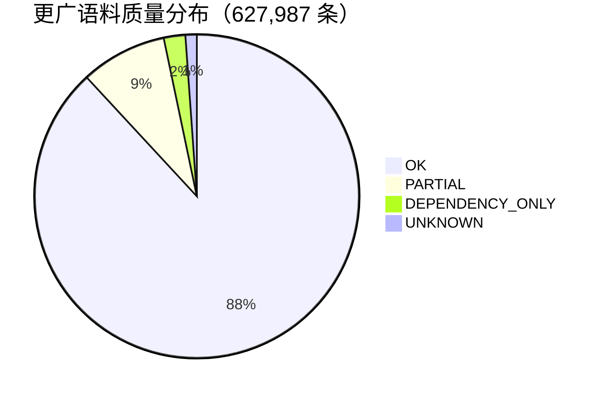
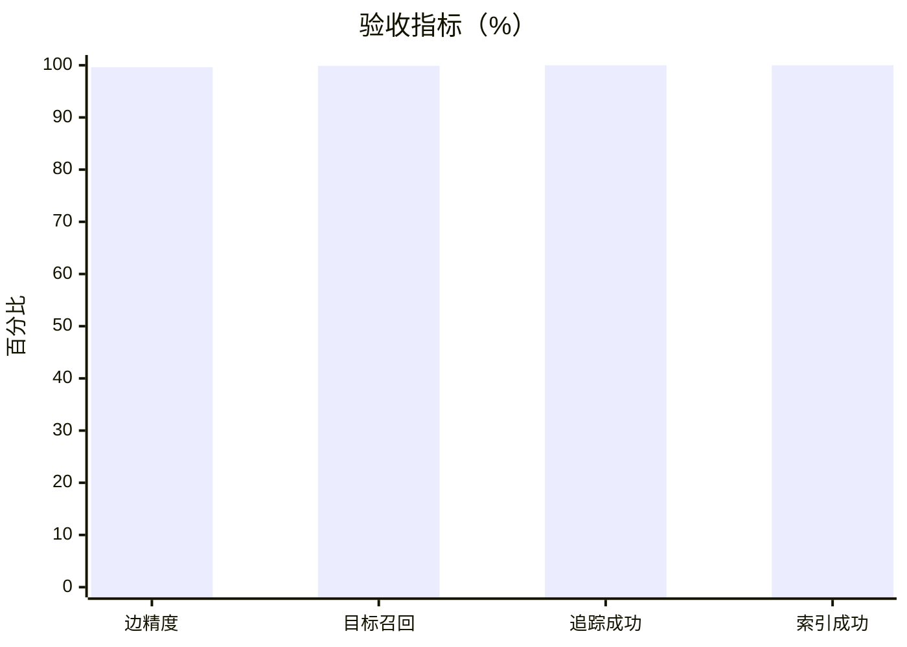

<div align="center">

# field-trace-graph

[English](README.md) | **简体中文**

**Java代码的 字段级追溯其来源————一条命令，完全本地。**

`ftg` 为本地 Java 工程构建字段级血缘图，回答“这个值从哪里来、又流向了哪里？”——不需要服务器、不上传源码、不依赖模型、没有后台进程。

[](https://www.npmjs.com/package/field-trace-graph)
[](https://opensource.org/licenses/Apache-2.0)
[](https://nodejs.org/)
[](#支持的平台)

```bash
npm install -g field-trace-graph && ftg --version
```

[快速开始](#快速开始) · [核心特性](#核心特性) · [命令参考](#命令参考) · [故障排查](#故障排查)

</div>

## 目录

- [快速开始](#快速开始)
- [为什么选择 field-trace-graph？](#为什么选择-field-trace-graph)
- [核心特性](#核心特性)
- [支持的平台](#支持的平台)
- [命令参考](#命令参考)
- [环境变量](#环境变量)
- [语义分析与隔离](#语义分析与隔离)
- [泛型与框架适配器](#泛型与框架适配器)
- [工程识别与语言级别](#工程识别与语言级别)
- [字段血缘语义契约](#字段血缘语义契约)
- [外部类路径](#外部类路径)
- [索引位置](#索引位置)
- [输出](#输出)
- [故障排查](#故障排查)
- [开发](#开发)
- [发布](#发布)
- [许可证](#许可证)

## 快速开始

### 1. 安装

```bash
npm install -g field-trace-graph
```

需要 Node.js 18 或更高版本；不需要系统安装 JDK，每个发布包都自带运行时。安装后会得到两个命令名：`field-trace-graph` 和短名 `ftg`，下文示例使用 `ftg`。

首次运行——包括只执行 `ftg --version`，因为启动器必须先准备好发布包才能转发参数——启动器会从内置发布清单中解析当前 OS/CPU 对应的归档，校验 SHA-256，解压到 `~/.field-trace-graph/dist/<version>`，然后把参数、信号和退出码转发给真正的可执行文件。首次下载约 200 MB；后续运行复用缓存，启动时间低于一秒。

```bash
# 固定版本（CI 应这样做），或升级、卸载。
npm install -g field-trace-graph
npm install -g field-trace-graph@latest
npm uninstall -g field-trace-graph

# 删除已下载的归档和运行时；下次运行会按需重新下载。
rm -rf ~/.field-trace-graph/dist
```

<details>
<summary><b>不用 npm——平台归档或本地 JAR</b></summary>

离线机器和发布调试可以完全绕过启动器：

```bash
# 已发布的归档：解压后不需要 JDK，也不需要 Node.js。
tar -xzf field-trace-graph-0.1.0-linux-x64.tar.gz
./bin/ftg --version

# 或者构建 shaded JAR，用本机 JDK 运行（见“开发”）。
java -jar lineage-cli/target/field-trace-graph.jar --version
```

</details>

### 2. 为工程建立索引

```bash
cd your-java-project
ftg init
```

`init` 一次构建完整图，并写入工程内的 `.field-trace-graph/trace.db`。它不会上传源码。

### 3. 追踪字段

在被分析的 Java 工程中执行命令。如果当前目录不是工程根目录，传入 `--project /path/to/project`。

```bash
# 查找方法。输出中包含可复制到下一个命令的方法签名。
ftg methods --name OrderService

# 查看方法内的值目标。
ftg targets --method 'com.example.OrderService#create(String,String)'

# 双向追踪指定的值目标。
ftg trace \
  --method 'com.example.OrderService#create(String,String)' \
  --target result.status \
  --direction both

# 调查字段如何到达调用方代码时，把调用方也纳入。
ftg trace \
  --method 'com.example.OrderService#create(String,String)' \
  --target result.status \
  --direction both \
  --call-scope full
```

所有命令默认输出文本；加 `--format json` 会在 stdout 输出一个 JSON 对象。进度和日志始终写入 stderr。

## 为什么选择 field-trace-graph？

Grep 只能告诉你一个名字出现在哪里，不能告诉你一个值如何真正到达某个字段——它可能经过 getter/setter、Builder、BeanCopy、MapStruct、Stream、MyBatis 参数桥，或者隔了两层调用的辅助方法。手工重建这条路径意味着逐个打开文件，并反复推导同样的链路。

`ftg` 只建一次图，然后直接回答：给定方法和目标表达式，返回双向的字段级边，每条边都带有产生它的文件和行号；解析停止时，返回显式的边界。每一跳要么有证据（`EXACT_STATIC`），要么明确标记为候选，因此你能看到结论是怎么来的，而不是相信一个黑盒。

所有内容都在本地针对工程内的 SQLite 索引运行——没有服务器、没有网络调用、没有源码上传。

## 核心特性

| | |
|---|---|
| **字段级血缘** | 追踪单个字段和访问路径（`result.status`、`goodTabCoupons[*].coupons`），而不只是方法调用 |
| **双向追踪** | `--direction in` 查谁写入了值，`out` 查值流向哪里，`both` 在目标处合并两个方向 |
| **逐边证据** | 每条边记录 `fileId`、行列范围、解析强度和证据来源；`ftg source` 可重新打印精确源码行 |
| **显式边界** | 未解析的流以命名原因结束（`CLASSPATH_MISSING`、`GENERATED_CODE_MISSING`、`RPC_BOUNDARY` 等），并给出建议动作，而不是静默留空 |
| **CI 质量门禁** | `--fail-on-candidate`、`--fail-on-reason`、`--fail-on-boundary-density`、`--max-weak-hops` 在图质量不足时返回退出码 `6` |
| **稳定的 JSON 输出** | `--format json` 在 stdout 输出一个带版本的对象；日志和进度始终写入 stderr |
| **框架感知** | 基于 JavaParser 的提取覆盖 Stream、Builder、BeanCopy、MapStruct、Lombok 生成成员、MyBatis Mapper XML 以及构造器/super 绑定 |
| **100% 本地** | 索引位于 `.field-trace-graph/trace.db` 的 SQLite；数据不离开本机 |

## 支持的平台

| 平台 | 架构 | 归档 |
|---|---|---|
| macOS | arm64 | `field-trace-graph-<version>-darwin-arm64.tar.gz` |
| macOS | x64 | `field-trace-graph-<version>-darwin-x64.tar.gz` |
| Linux | x64 | `field-trace-graph-<version>-linux-x64.tar.gz` |
| Windows | x64 | `field-trace-graph-<version>-win32-x64.zip` |

每个归档都自带 JDK 17 运行时，因此终端用户无需安装 JDK。

## 命令参考

除非特别说明，所有常规命令都接受 `--project PATH`。默认工程根目录从当前目录向上查找最近的 Git worktree、`pom.xml`、`build.gradle` 或 `build.gradle.kts`。

### 通用行为

- `--format text` 是默认格式。`--format json` 会在标准输出上输出一个 JSON 对象。日志和进度使用标准错误。
- `--language-level N` 覆盖从各模块检测到的语言级别。
- `--include-tests` 纳入测试源码根；默认排除测试。
- `methods`、`targets` 和 `trace` 查询前通常会同步本地索引。`--no-sync` 只读取现有图，不更新。
- `trace --allow-stale` 允许在刷新失败时读取上一个已发布的 generation。
- `init` 和 `index` 使用 `.field-trace-graph/index.lock` 串行化写入者。
- `--generated-sources PATH` 添加显式的注解处理器或生成源码根。该选项可重复或逗号分隔，不会猜测构建布局。证据文件位于这些根下的边会以 `provenance=GENERATED_SOURCE` 发布。
- `--classpath PATH` 添加显式的 JAR 或类目录。可重复或逗号分隔，参与索引上下文指纹，且绝不会从 `target/classes` 推断。读取 class 文件元数据时不会加载或执行依赖代码。
- `--classpath-file PATH` 从 `mvn dependency:build-classpath` 或 Gradle 任务生成的文件中读取类路径条目。条目可以一行一个，也可以用 `:`/`;` 分隔；相对路径按文件所在目录解析。该文件会与重复的 `--classpath` 选项合并。

### 证据与质量

每条逻辑边都有独立的 `resolution` 和 `provenance`：

```text
resolution: EXACT_STATIC / CANDIDATE / UNRESOLVED / RUNTIME_OBSERVED
provenance: SOURCE / GENERATED_SOURCE / BYTECODE / FRAMEWORK_ADAPTER /
            RUNTIME_TRACE / MANUAL_CONTRACT
```

`edge_evidence` 保存一条逻辑边的全部证据行。静态源码、框架适配器、生成源码和未来的运行时导入会累积，而不是互相覆盖。`trace --format json` 会暴露选中的顶层 `resolution`/`provenance`，以及每条边上完整的 `evidence[]` 数组。

开放边界不会被当作静默失败。每个边界都报告 `reasonCode`、`recoverable`、`suggestedAction` 和 `evidenceSource`。弱跳和歧义重载候选使用相同字段。典型动作包括 `run mvn generate-sources`、`provide --generated-sources`、`provide-classpath`、`import-runtime-trace` 或 `import-runtime-sql`。

边界原因是刻意细分的，方便确定下一步补证动作：

| `reasonCode` | 含义 | 首要动作 |
| --- | --- | --- |
| `CLASSPATH_MISSING` | 源码/导入中出现了接收者类型，但提供的类路径条目无法确认其成员。 | `provide --classpath` |
| `GENERATED_CODE_MISSING` | 成员是合成的或由处理器生成（Lombok、枚举 `values`/`valueOf`）。 | `provide --generated-sources` 或带生成源码重新构建 |
| `CALLEE_SYMBOL_MISSING` | 所属类型在源码中，但引用的成员不存在，且未知是否为生成。 | 带生成源码重新索引，或提供所属模块/类路径 |
| `RECEIVER_TYPE_UNKNOWN` | 接收者表达式本身无法定型，通常是以未解析值为根的链。 | 追踪接收者表达式，或导入运行时追踪 |
| `RPC_BOUNDARY` | Dubbo/gRPC/Thrift/CXF/Feign/JAX-WS 风格的远程调用边界。 | 提供契约或导入运行时证据 |
| `SERIALIZATION_BOUNDARY` | Fastjson/Jackson/Gson 风格的序列化或反序列化调用。 | 导入运行时证据或补充契约 |
| `RPC_SERIALIZATION` | 拆分前构建的旧索引中出现的合并原因码。 | 重新索引以得到具体原因 |
| `EXTERNAL_LIBRARY` | class 文件元数据确认了外部成员。 | 如果关心字段血缘，用运行时证据继续追踪 |
| `PLATFORM_LIBRARY` | JDK/平台调用。默认视为闭合，不计入未知边界密度。 | 无 |
| `OVERLOAD_AMBIGUOUS` | 类型收窄后仍有多个同参数数量的目标。 | 用类型消歧，或提供所属类路径 |

`EXTERNAL` 只作为无法命名接收者类型时的旧版兜底保留。新索引在正常使用中不应累积它；质量报告和契约应消费具体原因码。

### 显式工程契约

FTG 不会读取 `application.yml` 来推断血缘。工程可以在根目录添加 `.field-trace-graph/contracts.yml`：

```yaml
version: 1
generatedSources:
  - target/generated-sources/annotations
contracts:
  - from: source.orderStatus
    to: RETURN.status
    reason: "MapStruct qualifiedByName converter"
    owner: "order-team"
    expiresWhen: "Source.orderStatus is removed"
    confidence: EXACT_STATIC
```

生成源码条目与重复的 `--generated-sources` 选项完全等价。契约必须包含 `from`、`to`、`owner`、`reason` 和 `expiresWhen`，否则会被忽略并告警。当 `expiresWhen` 包含日历日期（`YYYY-MM-DD`）时，过期契约会被跳过并告警。`trace --strict-contracts` 会把不完整、过期或未匹配的契约变成硬失败。FTG 会用发现到的最短证据路径匹配契约，因此批准的端点之间可以隔着中间 setter 或赋值。每条匹配路径边都会追加一条 `MANUAL_CONTRACT` 证据行；源码证据永远不会被移除。

### 导入运行时证据

运行时采集可以导入观测结果，而不重写静态图：

```bash
field-trace-graph evidence import \
  --file runtime-evidence.json \
  --format json
```

```json
{
  "schemaVersion": 1,
  "evidence": [
    {
      "logicalEdgeKey": "... copy from trace edges[].evidence[].logicalEdgeKey ...",
      "evidenceKind": "METHOD_ARGUMENT",
      "adapter": "opentelemetry",
      "rule": "observed by checkout integration test",
      "coverage": "one execution of checkout-e2e",
      "observedAt": "2026-11-09T00:00:00Z",
      "details": {"traceId": "..."}
    }
  ]
}
```

导入行使用 `resolution=RUNTIME_OBSERVED` 和 `provenance=RUNTIME_TRACE`。`coverage` 是必填项，因为一次运行时命中只能证明被观测到的执行路径，不能证明所有分支。原始静态或适配器证据仍保留在 `edge_evidence` 和 trace 的 `evidence[]` 数组中。

同一命令会自动识别 OpenTelemetry OTLP JSON 和 JFR JSON 导出。把 `ftg.logicalEdgeKey` 和 `ftg.coverage` 作为 span 属性携带（可以直接作为属性，也可以放在 OTLP `attributes` 数组或 JFR `values` 对象中）。可选属性包括 `ftg.scopeSymbolId`、`ftg.evidenceId`、`ftg.sourceEdgeId`、`ftg.evidenceKind`、`ftg.adapter` 和 `ftg.rule`。`startTimeUnixNano` 会转换为 `observedAt`。没有 `ftg.logicalEdgeKey` 的属性会被忽略，而不是猜测。

导入前可将采集到的 key 与当前静态图比较：

```bash
field-trace-graph evidence diff \
  --file runtime-evidence.json \
  --fail-on-missing \
  --format json
```

`evidence diff` 会报告 `observedCount`、`matchedCount`、`missingCount` 和 `matchRatio`。缺失 key 表示运行时采集与已发布图不一致；它不会被用来凭空创建边。`--fail-on-missing` 返回退出码 `3` 并给出诊断 `RUNTIME_EVIDENCE_DRIFT`，适合 CI 漂移检查。

### `field-trace-graph` 与 `--help`

```bash
field-trace-graph
field-trace-graph --help
field-trace-graph --version
```

不带子命令时打印应用横幅。`--help` 打印顶层命令列表。`--version` 打印应用版本和 schema 版本。这些输出可用于确认当前安装的是哪个二进制。

### `init`

```bash
field-trace-graph init [OPTIONS]
```

初始化工程并执行一次完整的本地索引。它会创建 `.field-trace-graph/trace.db`，分析 Java 源码和语义调用，并发布初始图 generation。如果仍有语义诊断，结果可能是 `PARTIAL`。新 checkout 运行一次即可；后续刷新使用 `index`。

| 选项 | 默认值 | 作用 |
|---|---:|---|
| `--project PATH` | 当前检测到的根目录 | 要建索引的工程目录。 |
| `--format text / json` | `text` | 结果输出格式。 |
| `--lock-timeout SECONDS` | `30` | 等待工程写锁的时间。 |
| `--index-timeout SECONDS` | `300` | 首次索引允许的最长时间。 |
| `--language-level N` | 自动检测 | 强制使用一个 Java 语言级别。 |
| `--include-tests` | `false` | 同时索引测试源码根。 |
| `--generated-sources PATH` | 无 | 显式的生成源码根；可重复或逗号分隔。 |
| `--classpath PATH` | 无 | 显式的 JAR 或类目录；可重复或逗号分隔。 |

### `index`

```bash
field-trace-graph index [OPTIONS]
```

构建或刷新本地图。默认增量执行（不带 `--full`）。需要完整重建时使用 `--full`，例如修改解析规则或编译上下文后。

| 选项 | 默认值 | 作用 |
|---|---:|---|
| `--project PATH` | 当前检测到的根目录 | 要建索引的工程目录。 |
| `--full` | `false` | 强制全量重建，而不是增量更新。 |
| `--format text / json` | `text` | 结果输出格式。 |
| `--lock-timeout SECONDS` | `30` | 等待工程写锁的时间。 |
| `--index-timeout SECONDS` | `300` | 单次索引尝试允许的最长时间。 |
| `--language-level N` | 自动检测 | 强制使用一个 Java 语言级别。 |
| `--include-tests` | `false` | 同时索引测试源码根。 |
| `--generated-sources PATH` | 无 | 显式的生成源码根；可重复或逗号分隔。 |
| `--classpath PATH` | 无 | 显式的 JAR 或类目录；可重复或逗号分隔。 |

### `status`

```bash
field-trace-graph status [OPTIONS]
```

读取已发布的索引状态，不写入图。文本输出显示 generation、图状态、新鲜度、文件/符号/节点/边计数，以及最近一次失败尝试（如果存在）。用它确认 `init` 或 `index` 发布的内容符合预期。

| 选项 | 默认值 | 作用 |
|---|---:|---|
| `--project PATH` | 当前检测到的根目录 | 要检查索引的工程。 |
| `--format text / json` | `text` | 结果输出格式。 |
| `--language-level N` | 自动检测 | 覆盖状态检查使用的语言级别。 |
| `--include-tests` | `false` | 使用包含测试的源码范围。 |
| `--generated-sources PATH` | 无 | 新鲜度检查使用的显式生成源码根。 |
| `--classpath PATH` | 无 | 新鲜度检查使用的显式 JAR 或类目录。 |
| `--classpath-file PATH` | 无 | 合并进新鲜度上下文的类路径文件。 |
| `--quality` | `false` | 输出 exact/candidate/unresolved 比例、开放边界、每 1000 个方法的密度以及主要边界原因。 |
| `--fail-on-boundary-density N` | 无 | 每 1000 个方法的开放边界超过 `N` 时返回退出码 `6`。 |
| `--fail-on-reason CODE` | 无 | 出现规范边界原因时返回退出码 `6`；可重复或逗号分隔。 |

`openBoundaryCount` 和 `openBoundaryDensityPer1000Methods` 不包含 `PLATFORM_LIBRARY` 调用，例如 `String.valueOf` 或 `Long.parseLong`。这些是已知的 JDK 边界，不是未知的工程证据；它们仍会出现在 `trace` 的 boundary 和 weak hop 中。

`frameworkAdapterEdgeCount` / `frameworkAdapterRatio` 把适配器有意产生的候选（MapStruct、MyBatis、Jackson/Fastjson 字段序列化）与真正的歧义候选区分开。发布门禁如果应忽略附加适配器证据，可使用 `ambiguousCandidateEdgeCount()` / `ambiguousCandidateRatio()`。

文本输出把符号计数拆成可比较的桶：

```text
types=... methods=... businessMethods=... accessors=... constructors=... initializers=...
```

`methods` 包含声明的业务方法、访问器和合成初始化器。`businessMethods` 是默认的 `methods` 搜索范围。`accessors` 统计 getter/setter，但不会把它们从图中移除；它们的字段流证据仍然保留。

### `methods`

```bash
field-trace-graph methods --name NAME [OPTIONS]
```

按名称片段搜索类、方法和构造器候选。文本输出打印完整方法签名，不包含内部 ID。可以直接把签名复制到 `targets --method` 或 `trace --method`。

| 选项 | 默认值 | 作用 |
|---|---:|---|
| `--name NAME` | 必填 | 类名或方法名片段。 |
| `--project PATH` | 当前检测到的根目录 | 要搜索的工程。 |
| `--format text / json` | `text` | 结果输出格式。 |
| `--offset N` | `0` | 跳过的匹配候选数。 |
| `--limit N` | `30` | 最多打印的候选数。 |
| `--no-sync` | `false` | 搜索前不刷新索引。 |
| `--language-level N` | 自动检测 | 需要刷新时覆盖语言级别。 |
| `--include-tests` | `false` | 同时搜索测试源码根。 |
| `--include-accessors` | `false` | 在搜索结果中包含 getter/setter 符号。 |
| `--classpath PATH` | 无 | 需要刷新时使用的显式 JAR 或类目录。 |

### `targets`

```bash
field-trace-graph targets --method SIGNATURE [OPTIONS]
```

列出可以传给 `trace --target` 的值表达式，以及它们的种类和源码位置。列表包含方法作用域值和在被调方发现的、有证据的字段路径，因此参数 `orderRequest` 也会暴露 `orderRequest.addressId`、`orderRequest.originId` 等真正参与血缘的字段。方法选择器通常应是 `methods` 打印的完整签名；自动化场景也接受稳定的方法 ID。

摘要把字段血缘与调用表达式记账分开：

```text
Targets: 45 (comparable=37 fields=29 roots=7 returns=1 calls=8)
```

`comparable` 是 `fields + roots + returns`。`calls` 包含 `CALL_RESULT`/`CONSTRUCTOR_RESULT` 目标，例如 `call:queryByOrderId(1)`；它们仍可选中，但在比较图实现时不应计为对象或字段血缘。

| 选项 | 默认值 | 作用 |
|---|---:|---|
| `--method SIGNATURE` | 必填 | 方法签名或稳定方法 ID。 |
| `--project PATH` | 当前检测到的根目录 | 要查询的工程。 |
| `--format text / json` | `text` | 结果输出格式。 |
| `--offset N` | `0` | 跳过的匹配目标数。 |
| `--limit N` | `30` | 最多打印的目标数。 |
| `--no-sync` | `false` | 查询前不刷新索引。 |
| `--language-level N` | 自动检测 | 需要刷新时覆盖语言级别。 |
| `--include-tests` | `false` | 同时搜索测试源码根。 |
| `--classpath PATH` | 无 | 需要刷新时使用的显式 JAR 或类目录。 |

### `trace`

```bash
field-trace-graph trace \
  --method SIGNATURE \
  --target EXPRESSION \
  [OPTIONS]
```

追踪选中值或字段的来源与流向。对象目标会按“有证据的字段追踪”并集求值，使对象级查询贴近真实字段血缘，而不是走进每一个下游对象。文本输出包含节点、有序链路、数据/调用边、边界、叶子、歧义重载候选、弱跳和源码证据。内部 `PHI`/分支版本会保留在 JSON 中，但从主节点列表中折叠掉。

默认 `--call-scope effective` 把加载的血缘限制在选中方法及其被调方，让字段查询聚焦于真实生产者和消费者，而不是扩散到所有无关调用方。只有在调查字段如何到达调用方代码时才使用 `--call-scope full`；它还会加载调用方，在大型调用图上可能触发深度或边数限制。

`leaves` 是各方向的停止点。`weakHops` 是源码可见、但无法桥接到已分析源码的调用，例如 JDK 或外部服务。只报告接触被追踪值或其作用域的弱跳；同一方法中无关的调用不会降低字段结果。它们仍是显式边界，但不能证明字段已被完整追踪：只要存在相关弱跳，`completeness` 就报告 `PARTIAL`。这样把边质量（`quality`，只看已发射的字段值边）与连通完整性分开。边界和叶子携带 `evidenceId`、`sourceFile` 以及结构化行列范围；弱跳携带 `callSiteId`、`sourceFile`、结构化行列范围、`resolution=UNRESOLVED`、`reasonCode`、`recoverable`、`suggestedAction` 和 `evidenceSource`。外部调用以声明类型命名，例如 `com.example.RemoteApi#fetch(java.lang.String)`，以便提供给契约或运行时采集。`RPC_BOUNDARY` 表示 class 文件或框架注解识别出了远程调用；`SERIALIZATION_BOUNDARY` 表示调用了 Fastjson/Jackson/Gson 风格的序列化器或反序列化器；`CLASSPATH_MISSING` 表示编译器看到了符号，但提供的类路径不包含它。MyBatis SQL 边界指向 mapper XML 文件和绑定表达式，而不是 mapper 接口行。`snapshotConsistent` 确认每条边都解析到同一个已发布索引 generation 的证据。`fileIndexes` 是本次追踪去重后的文件级证据索引。`evidenceIssues` 报告缺失或无哈希的证据，`noMatchReason` 区分“目标有效但没有数据边”和“字段不存在”。

每条边还携带 `operation`、`depth`、`resolved`、`bridged`、`srcScope`、`dstScope`、`sourceFile`、`lineStart`、`lineEnd`、`argIndex` 和 `argLevel`。`operation` 在可用时是存储的源码表达式，否则是边类型的可读标签，因此 JSON 消费者不需要从原始 ID 推断步骤。调用结果生产者跳使用 `CALL_PRODUCER`，暴露接收者到结果的关系，包括 `paymentService.fetchMerchantConfig(...)` 这样的外部调用。

当产生边的语句与目标节点的版本锚点不在同一行时，文本输出会在边上追加 `at=<File.java>:<line>`。整对象复制（`COPY_ALL`）、容器元素聚合（`list[*]`）和被调方副作用桥的版本锚点保留在接收变量上（通常是声明处）；`at=` 给出精确的复制、`add`/`put` 或调用行，读者可以同时确认值版本和移动它的操作。JSON 已通过 `sourceFile` + `lineStart` 暴露同一位置。

对于从容器元素投影出的字段（`list[*].field`），`effect=` 锚点跟随选中的字段节点，而不是元素分配点。例如 `msgList.add(dto)` 在 `dto.ownerId` 是选中字段时，会把 `dto.setOwnerId(...)` 报告为 effect；只有在被分析源码之外构建的元素才回退到插入行。

`Evidence:` 块打印 `<path>:<line>:<column>:<endColumn>`，随后是该位置精确的源码文本。多行语句会折叠为单个空格，以保持片段可比较；被调方副作用桥会额外增加 `effect=<File.java>:<line>` 列，而不是修改片段；因此打印的表达式始终能复现引用的源码文本。

每条边还携带 `category`：

- `FIELD_VALUE`：字段或值血缘。
- `CALL_STRUCTURE`：`CALL_PRODUCER` 等调用生产者跳。
- `DEPENDENCY`：由 `--include-dependencies` 纳入的显式控制/调用输入依赖边。
- `DIAGNOSTIC`：不参与字段值质量的解释性边界或结构边。

`quality` 只针对字段值边评估。`structureEdges`、`structureUnresolvedEdges` 和 `structureStatus` 单独报告调用生产者缺口；`diagnosticEdges`、`diagnosticUnresolvedEdges` 和 `diagnosticStatus` 对解释性边界做同样的事。未解析的结构边或诊断边保持可见，但不会让完整的字段血缘看起来不完整。只有真正的深度、边数、目标种子或时间限制才会设置 `truncated`。对象目标展开与遍历使用同一个查询 deadline。

`chains[]` 是对权威 `edges[]` 的完整展示投影。每条链有 `edgeIds` 和 `hops[]`；每个 hop 包含 `edgeId`、`srcNodeId`、`dstNodeId`、`edgeType`、`operation`、`resolution`、`resolved`、`bridged`、`direction`、`sourceFile`、`lineStart` 和 `lineEnd`。一条链无需把 edge ID 重新 join 回边集合即可渲染。文本输出为每条展示的链显示 `hops=N`。

`truncated` 和 `truncationReasons` 描述有意的有界输出。`cycleDetected` 表示完整的去重边集合中存在有向环；它是诊断信息，本身不是截断。没有固定的链路数量投影上限，文本输出会打印全部链路和全部弱跳，而不是只采样前十条。`truncationReasons` 可能包含 `DEPTH_LIMIT`、`EDGE_LIMIT`、`SEED_LIMIT` 和 `TIME_LIMIT`。边和深度限制仍是显式请求选项，调用方可以为超大的诊断查询设置边界，而不会静默缩短默认字段血缘结果。`-1` 是唯一的自动预算值；`0` 和其他负值会被拒绝。

`completeness` 是面向用户的连通性结论。`COMPLETE` 要求字段值边已解析、没有候选证据、没有截断、快照证据一致，并且没有相关弱跳或 `USE_UNRESOLVED` 边界。`PARTIAL` 表示已发射的边可用，但某个可见消费者无法继续跟随。`INSUFFICIENT`、`UNKNOWN` 和 `INCOMPLETE` 保持下文所述的质量门禁含义。JSON 输出暴露相同的值和原因。

终止边界区分三种状态：

- `USE_UNRESOLVED`：源码中存在消费者调用，但其方法体无法分析。这是桥接缺口，不是“未使用”。
- `CONSUMED_BY_CALL`：值被传入一个结果不暴露该字段的调用（通常是 `void` 方法）。消费者是真实存在的。
- `NO_USE` / `NO_CONSUMER`：在已分析源码中没有出边，也没有消费调用点。文本输出明确标记为 `NO_CONSUMER`；它表示“已分析代码中没有找到消费者”，不是对运行时业务行为的断言。

只有已分析作用域中存在根和访问路径完全一致、且有证据的字段时，点号目标才会被接受；否则 `trace` 返回 `NO_MATCH` 和 `FIELD_NOT_FOUND`，不会凭空发明路径。文本输出用完整签名标识方法，用表达式标识值；稳定 ID 只出现在 JSON 中供机器 join。

退出状态跟随连通性结论：`COMPLETE` 为 `0`；`PARTIAL` 或 `INSUFFICIENT` 使用“陈旧/不完整”退出码 `3`。`--max-weak-hops N` 仍是更严格的显式门禁，超过预算时返回 `6`。只有在本次运行可以接受候选证据时才使用 `--allow-resolution candidate`；它不会隐藏弱跳或未桥接消费者。

| 选项 | 默认值 | 作用 |
|---|---:|---|
| `--method SIGNATURE` | 必填 | 方法签名或稳定方法 ID。 |
| `--target EXPRESSION` | 必填 | 来自 `targets` 的目标，例如 `result.status`。 |
| `--direction in / out / both` | `both` | 追踪上游、下游或双向。 |
| `--call-scope effective / full` | `effective` | 跟随选中方法及被调方，或同时包含调用方。 |
| `--include-dependencies` | `false` | 包含控制、调用输入和变更副作用依赖边。 |
| `--project PATH` | 当前检测到的根目录 | 要查询的工程。 |
| `--format text / json` | `text` | 结果输出格式。 |
| `--no-sync` | `false` | 追踪前不刷新索引。 |
| `--allow-stale` | `false` | 刷新失败时读取上一个 generation。 |
| `--max-depth N` | 自动 | 最大遍历深度；`-1` 对字段目标取 30，对对象目标取 100。`0` 非法。 |
| `--max-edges N` | 自动 | 最大遍历边数；`-1` 对字段目标取 2500，对对象目标取 5000。`0` 非法。 |
| `--query-timeout SECONDS` | `0` | 最大查询时间；`0` 关闭限制。 |
| `--language-level N` | 自动检测 | 需要刷新时覆盖语言级别。 |
| `--include-tests` | `false` | 在分析中包含测试源码根。 |
| `--generated-sources PATH` | 无 | 刷新和新鲜度检查使用的显式生成源码根。 |
| `--classpath PATH` | 无 | 刷新、class 文件元数据和新鲜度检查使用的显式 JAR 或类目录。 |
| `--classpath-file PATH` | 无 | 刷新和新鲜度检查使用的类路径文件。 |
| `--allow-resolution exact / candidate` | `exact` | 接受候选边作为完整输出。未解析证据仍会失败。 |
| `--fail-on-candidate` | `false` | 只要存在候选证据就返回非零退出码，即使设置了 `--allow-resolution candidate`。 |
| `--max-weak-hops N` | `-1` | 弱跳数超过 `N` 时返回退出码 `6`；`-1` 关闭门禁。 |
| `--strict-contracts` | `false` | 对不完整、过期或未匹配的 `.field-trace-graph/contracts.yml` 条目失败。 |

### `source`

```bash
field-trace-graph source \
  --file src/main/java/Example.java \
  [--start 1] [--end 20] \
  [OPTIONS]
```

读取一段有界源码用于证据复核。文件路径相对于工程根目录。默认范围是第 1 行到第 20 行。

| 选项 | 默认值 | 作用 |
|---|---:|---|
| `--file PATH` | 必填 | 相对源码文件路径。 |
| `--start N` | `1` | 读取的起始行。 |
| `--end N` | `20` | 读取的结束行。 |
| `--project PATH` | 当前检测到的根目录 | 文件所属工程。 |
| `--format text / json` | `text` | 结果输出格式。 |
| `--language-level N` | 自动检测 | 覆盖源码范围使用的语言级别。 |
| `--include-tests` | `false` | 允许测试源码根下的文件。 |

### `doctor`

```bash
field-trace-graph doctor [OPTIONS]
```

检查本机运行时环境。它报告 Java 版本、编译器是否可用、SQLite JDBC 是否可用、操作系统/架构，以及工程索引文件是否存在。它不会创建或更新索引。

| 选项 | 默认值 | 作用 |
|---|---:|---|
| `--project PATH` | 当前检测到的根目录 | 检查索引是否存在的工程。 |
| `--format text / json` | `text` | 结果输出格式。 |

## 环境变量

无需修改 properties 文件即可覆盖运行时规模和超时预算：

| 变量 | 用途 |
|---|---|
| `FIELD_TRACE_GRAPH_PARSER_VERSION` | 覆盖解析器/schema 兼容版本。 |
| `FIELD_TRACE_GRAPH_SOURCE_MAX_FILES` | 一次扫描允许的最大源码文件数。 |
| `FIELD_TRACE_GRAPH_SOURCE_MAX_FILE_BYTES` | 单个源码文件的最大字节数。 |
| `FIELD_TRACE_GRAPH_SOURCE_MAX_TOTAL_BYTES` | 一次扫描允许的源码总字节数。 |
| `FIELD_TRACE_GRAPH_SOURCE_MAX_DEPTH` | 源码树最大深度。 |
| `FIELD_TRACE_GRAPH_INDEX_LOCK_TIMEOUT_MILLIS` | 默认索引锁等待毫秒数。 |
| `FIELD_TRACE_GRAPH_INDEX_TIMEOUT_MILLIS` | 默认索引超时毫秒数。 |
| `FIELD_TRACE_GRAPH_QUERY_TIMEOUT_MILLIS` | 默认追踪查询超时毫秒数。 |
| `FIELD_TRACE_GRAPH_QUERY_MAX_DEPTH` | 默认最大遍历深度。 |
| `FIELD_TRACE_GRAPH_QUERY_MAX_EDGES` | 默认最大遍历边数。 |
| `FIELD_TRACE_GRAPH_QUERY_MAX_CALLEE_DEPTH` | 被调方展开的最大深度。 |

构建和发布变量包括 `JAVA_HOME`、`FTG_JAVA_HOME`、`FTG_RUNTIME_HOME`、`FTG_BUNDLE_RUNTIME`、`FTG_STRICT_RELEASE`、`VERSION`、`OS` 和 `CPU`。`FTG_SKIP_BUILD=1` 在发布构建中复用已有 JAR；`FTG_SKIP_SECURITY_SCAN=1` 仅在调用方另有批准的扫描步骤时才跳过安全扫描。

## 语义分析与隔离

编译期诊断在独立的 `SemanticWorkerMain` 子进程中运行，由 `SemanticWorkerLauncher` 启动。worker 受超时、堆上限和响应大小上限约束，其私有临时目录总会被删除。注解处理器、隐式源码发现和目标工程代码永远不会被执行。

## 泛型与框架适配器

成员解析会保留声明的泛型类型。`Wrapper<Order>` 上返回 `T` 的字段或方法会解析为 `Order`；集合、Optional、Future 和 Map 的读取会解析元素/key/value 类型，而不是擦除为 `Object`。当源码声明可用时，构造器、Stream、BeanCopy 和接收者类型判断都会使用这些信息。

隐式 lambda 参数会从它遍历的集合、Stream、Optional 或 Map 推断类型（`users.stream().map(user -> user.getName())` 把 `user` 绑定到 `List<User>` 的元素）。这能让 lambda 体内的调用分派保持精确，而不是退化为未知接收者边界。

Bean 序列化是框架适配器：Fastjson `JSON.toJSONString`、Jackson `writeValueAsString` 和 Gson `toJson` 会把声明字段展开成“字段到结果”的边。基于注解的排除（例如 `@JSONField(..., serialize = false)` 和 `@JsonIgnore`）会被尊重。这些边以 `resolution=CANDIDATE` 和 `provenance=FRAMEWORK_ADAPTER` 发布；导入运行时追踪以确认实际被序列化的字段。日志或遥测调用内部嵌套的序列化调用会被忽略，因此 `log.info("{}", JSON.toJSONString(bean))` 不会创建字段血缘边。日志接收者通过声明的 `Logger`/`Log` 类型、常见日志包以及 `LoggerFactory.getLogger(...)` 等标准工厂调用识别。厂商特定的监控工具不会被硬编码为日志器；除非其声明类型证明它是日志器，否则它们仍是普通调用边界。接收者名称包含 `Logger` 且方法名包含日志级别的包装工具（例如 `AuditLogger.reportError`）仍会被视为诊断 sink。

Tuple 工厂按参数数量展开：Commons `Pair`/`Triple` 暴露 `left`/`middle`/`right`，JavaTuples 暴露 `value0..N`，Reactor/Vavr `TupleN` 同时暴露 `tN` 和 `_N`。`Map.entry(k, v)` 建模为 `key`/`value`。`List.of`、`ImmutableList.of`、`Lists.newArrayList`、`Optional.of` 等集合工厂保持元素流；透明包装器（`Objects.requireNonNull`、`Optional.orElse`、`StringUtils.defaultIfNull`）保留输入，而不是变成外部边界。空集合工厂以及集合/Map 构造器不计入弱跳，因为它们不可能消费字段值。

`Optional` 和 `CompletableFuture` 是单值包装器。`map`、`flatMap`、`filter`、`thenApply`、`thenCompose`、`handle` 等回调方法会投影到具体字段路径，包括方法引用（`Optional.map(Bean::getAddress)`）。终端方法（`orElse`、`join`）和直接 `return` 保持同一字段路径，因此 `bean.address.city` 可以贯穿整个包装链，而不是停在 JDK 调用处。常见纯工具类 owner（`StringUtils`、`CollectionUtils`、`ObjectUtils`、`NumberUtils`、`BooleanUtils`、`ArrayUtils`、`MapUtils`、`Objects`）被视为透明转换，而不是未解析外部调用。

MyBatis mapper XML 通过 namespace 发现，而不是硬编码 `/mapper/` 目录。绑定变量保留 XML 行列元数据；通过 `<include>` 到达的 `<sql>` 片段会展开以发现参数，`<foreach>` item 别名会映射回其集合参数。SQL 绑定边在存在 Java 参数/字段值节点时复用该节点，使 SQL 边界保持与 Java 血缘链连接。旧版 iBatis 2 `<sqlMap>` 文件在 namespace 映射到带 `@Dao(value = "...")` 注解的类型时也会被识别；`parameterClass` 和 `resultClass` 被接受为 `parameterType` 和 `resultType` 的别名，`#param#` / `$param$` 绑定语法会归一化到同一 SQL 边界模型。

## 工程识别与语言级别

除非传入 `--project`，工程根目录是当前目录向上最近的 Git worktree、`pom.xml` 或 `build.gradle`。每个模块的 Java 语言级别会从 `pom.xml`（`release`、`maven.compiler.release`、`maven.compiler.source`、`source`）或 `build.gradle`（`options.release`、`sourceCompatibility`）静态读取。模块会从父目录继承编译器配置，直到工程根。没有静态语言级别的模块回退到 Java 17，并标记为 assumed。

## 字段血缘语义契约

- `both` 默认使用 `effective` 调用范围：选中方法及其被调方。扩展调用方需要 `--call-scope full`。
- 字段值遍历使用赋值、字段写入、返回值、容器复制、构造器/Builder/BeanCopy 流，以及显式的调用实参/返回值绑定。`ARGUMENT_TO` 是调用边界传输边，不是 `ASSIGNED_FROM` 的值来源断言。
- `CONDITION_USES` 和 `CALL_INPUT_USES` 是依赖证据，不是字段值边。默认排除，仅在 `--include-dependencies` 时出现。为 `if`、三元、`switch` 和 guard 表达式保留 `CONDITION_USES` 是有意设计：条件控制运行哪个分支，而不是产生哪个值，因此不能提升为字段值边。
- 声明在接口或抽象类上的虚调用会桥接到每一个已分析的源码实现，而不只是第一个。每条实现边都是 `CANDIDATE`；实参和返回字段桥随后在每个方法体内继续。单一源码实现是 `VIRTUAL_UNIQUE`，保持精确。这与泛型 Java 接口和 RPC 风格服务接口使用同一分派规则。接口可以来自依赖 JAR；当擦除后的参数类型匹配调用时，源码实现仍会被桥接。
- 存储对象引用的 setter（`holder.setRequest(request)`）和后续 getter（`holder.getRequest()`）形成对象值属性桥。getter 结果上读取的字段继续作为该对象的字段，而不是 `holder.request.field`；`void` 调用不会在结果上发明字段。
- 日志、监控和遥测读取不是字段血缘。
- 未知外部调用停在 `EXTERNAL_BOUNDARY`；它们绝不会被改写为已确认的字段赋值边。
- 面向用户的目标以业务字段为主。`RETURN` 是 `RETURN`，构造器结果是 `CONSTRUCTOR_RESULT`，普通调用结果是 `CALL_RESULT`。getter/setter 调用语法会归一化为其业务字段。
- `this.field`、具体变量字段和构造器结果字段保留各自所属作用域。它们共享相同的规范字段后缀，但来自不同接收者对象的字段不会仅因名称相同而合并。
- 追踪质量是确定性的，只根据字段值边计算。候选边与未解析边分开报告；只要存在候选证据，结果就是 `PARTIAL`。未解析值边低于 10% 为 `OK`；10% 到低于 30%，或存在未解析值边的实际截断为 `PARTIAL`；30% 及以上为 `INSUFFICIENT`。完全没有字段值证据为 `UNKNOWN`。部分语义索引、未解析的调用结构边或未解析的诊断边本身不会降低完整字段血缘；这些缺口仍会显示在 `structureStatus` 和 `diagnosticStatus` 中。已解析边在任何情况下都保持可用。

## 外部类路径

在工程根目录放置可选的 `.semantic-classpath.xml`。规范格式与语义类路径索引器共享：

```xml
<?xml version="1.0" encoding="UTF-8"?>
<semanticClasspath version="1">
  <module path="order-service-common" sourceSet="main">
    <jar path="semantic-libs/commons-lang3-3.5.jar"
         sha256="64-lowercase-hex-characters"/>
  </module>
</semanticClasspath>
```

路径相对于工程，且每个 JAR 的哈希都是必填的。旧的 `<classpath><entry .../></classpath>` 格式仍可读取以保持本地兼容，但新文件应使用规范 schema。工具会校验每个本地 JAR，但不会运行 Maven、Gradle、注解处理器或工程代码，也不会下载依赖。缺少 manifest 是允许的，但当 javac 无法解析外部类型时会产生 `PARTIAL` 图；无效 manifest 会被拒绝，而不是静默忽略。

一次性构建时，可以显式传入相同的条目：

```bash
field-trace-graph index \
  --classpath target/classes \
  --classpath ~/.m2/repository/com/example/api/1.0/api-1.0.jar
```

接受目录和 JAR。工具读取 class 文件名、方法描述符和类级注解，以区分 `RPC_SERIALIZATION`、`EXTERNAL_LIBRARY` 和 `CLASSPATH_MISSING`，过程中不加载类，也不执行其静态初始化器。`--classpath` 也参与新鲜度指纹：增加或删除条目会让现有索引变为 `STALE`，直到重新构建。

## 索引位置

SQLite 索引写入工程根目录下的 `.field-trace-graph/trace.db`。工具不会修改源码文件。

## 输出

传入 `--format json` 以在 stdout 输出单个 JSON 对象。日志和进度写入 stderr。退出码：`0` 成功，`2` 用法错误/未找到，`3` 索引陈旧或缺失，`4` 内部/解析/存储错误，`5` 资源预算。

## 故障排查

**首次运行看起来卡住**——它正在下载平台归档（约 200 MB）。任意命令的首次调用都会这样，包括 `--version`。启动器会向 stderr 写入 `downloading <archive> (<size>)...` 和 `downloaded <archive> (<size>) in Ns`；后续运行会在一秒内启动。

**`init` 卡住**——很可能在不是工程根目录的目录上建索引（在 `~` 下运行会遍历整个 home 目录）。请在工程内运行，或传入 `--project /path/to/project`。

**`ftg` 和 `field-trace-graph` 行为不同**——不会：两者都是同一启动器的符号链接。运行 `type -a ftg`；旧的 shell alias 会遮蔽已安装命令。

**修改代码后结果看起来陈旧**——`init` 和 `index` 会刷新图。只有确实想读取现有索引时才使用 `--no-sync`。

**Lombok 类的 getter/setter 流提前停止**——生成成员不在源码中。生成 delombok 输出，并传入 `--generated-sources <dir>`，让这些访问可以解析。

**追踪停在 `CLASSPATH_MISSING`**——接收者类型在源码中命名，但没有类路径条目确认其成员。传入 `--classpath`（或 `--classpath-file`），指向模块输出目录或依赖 JAR。

**`database is locked` 或缓存损坏**——删除 `~/.field-trace-graph/dist/`（启动器缓存）和 `.field-trace-graph/`（索引）；下次运行会重建两者。

**索引异常大**——检查 `target/`、`build/` 和生成目录是否被 `.gitignore` 覆盖，以及生成源码根是否通过 `--generated-sources` 显式传入，而不是作为普通源码索引。

## 开发

### 环境要求

- 使用已发布的 npm 包：Node.js 18 或更高版本。不需要系统 JDK。
- 从源码构建：JDK 17 或 21（含 `javac`）、Maven、Node.js 18 或更高版本。
- 发布构建：通过 `FTG_RUNTIME_HOME` 指定可再分发的 JDK 17 或 21。

### 构建

```bash
export JAVA_HOME=/path/to/jdk-17-or-21
mvn clean package
```

shaded 可执行 JAR 位于 `lineage-cli/target/field-trace-graph.jar`。

本地 JAR 构建可以在任意工程根目录运行，或传入 `--project`：

```bash
cd /path/to/java-project
java -jar /path/to/field-trace-graph.jar init
java -jar /path/to/field-trace-graph.jar methods --name OrderService
java -jar /path/to/field-trace-graph.jar trace \
  --method 'com.example.OrderService#create(String,String)' \
  --target result.status
```

为了缩短命令，可以在当前 shell 创建 alias：

```bash
alias ftg='java -jar /path/to/field-trace-graph.jar'
ftg init
```

### 模块

- `lineage-core`：领域模型、查询规则、端口和仅依赖 JDK 的共享工具。
- `lineage-java`：Java AST 提取、类型/调用解析和语义分析。
- `lineage-storage-sqlite`：SQLite schema、SQL、行映射和事务。
- `lineage-cli`：命令控制器、应用服务、视图和装配。
- `distribution/npm`：用于全局安装的轻量 Node 启动器。

### 开发命令

这些命令作用于本仓库，而不是被分析的 Java 工程。

```bash
# 编译所有模块并构建可执行 JAR。
mvn clean package
mvn -q clean package
```

本仓库不包含单元测试或回归测试框架，因此 `mvn test` 没有可运行内容。使用 `mvn clean package` 构建。

如果本地 Maven 缓存由另一个 Maven 安装填充，或机器离线，Maven 可能警告某个 artifact “cached from a remote repository ID that is unavailable in current build context”。artifact 已经存在，因此可以离线构建或关闭本地仓库跟踪：

```bash
mvn -o clean package     # 针对完整本地缓存的离线构建
mvn -llr clean package   # 旧式本地仓库，忽略缓存的 repo ID
```

shaded 可执行文件是 `lineage-cli/target/field-trace-graph.jar`。各模块 JAR 是构建产物，不是常规命令行入口。

### 诊断命令

本地图是 SQLite，可以直接安全地检查。以下命令是只读的：

```bash
# 列出表。
sqlite3 .field-trace-graph/trace.db ".tables"

# 查看一个已发布索引状态和表计数。
sqlite3 .field-trace-graph/trace.db <<'SQL'
SELECT 'files', COUNT(*) FROM source_file
UNION ALL SELECT 'symbols', COUNT(*) FROM source_code_symbol
UNION ALL SELECT 'nodes', COUNT(*) FROM value_node
UNION ALL SELECT 'edges', COUNT(*) FROM value_data_edge
UNION ALL SELECT 'call_edges', COUNT(*) FROM parsed_invoke_edge
UNION ALL SELECT 'method_summaries', COUNT(*) FROM method_summary
UNION ALL SELECT 'pending_refs', COUNT(*) FROM pending_parse_invoke_ref;

SELECT active_generation, graph_status, published_at,
       last_attempt_status, last_error_code
FROM full_index_state;
SQL
```

有用的检查：

- 排除测试时，`files` 应与预期的主 Java 源码数量一致。
- `status` 是检查最新 generation 是 `READY`、`PARTIAL` 还是陈旧的最简单方式。
- `doctor` 可以区分“缺少运行时/编译器”和“缺少索引”。

#### 索引计数与符号维度

`ftg status` 报告以下计数。它们是判断一个已发布 generation 是否覆盖预期源码树的权威检查。

`parsed_invoke_edge` 只存储到达被调方的调用（`EXACT_STATIC`、`COMPILE_TIME_TARGET`、`VIRTUAL_UNIQUE`、`CANDIDATE`）。未解析调用只记录一次，存放在 `pending_parse_invoke_ref` 中，并携带遍历期间保持接收者到结果桥所需的调用点载荷（分派类型、接收者、实参、结果值）。因此两张表不相交，其计数可以与区分 pending 引用的工具比较。`ftg status` 分别以 `calls=` 和 `pending=` 打印两个数字。

符号比较使用独立维度，而不是单个 `kind` 列：

```text
declaration kind: CLASS / INTERFACE / ENUM / RECORD / ANNOTATION /
                  METHOD / CONSTRUCTOR / INITIALIZER
symbol role:      BUSINESS / ACCESSOR_GET / ACCESSOR_SET / INITIALIZER
```

使用以下 FTG 计数进行比较：

```sql
SELECT
    COUNT(*) AS total_symbols,
    SUM(kind IN ('CLASS','INTERFACE','ENUM','RECORD','ANNOTATION')) AS type_count,
    SUM(kind = 'METHOD') AS method_count,
    SUM(kind = 'METHOD' AND symbol_role = 'BUSINESS') AS business_method_count,
    SUM(symbol_role IN ('ACCESSOR_GET','ACCESSOR_SET')) AS accessor_count,
    SUM(kind = 'CONSTRUCTOR') AS constructor_count,
    SUM(symbol_role = 'INITIALIZER') AS initializer_count
FROM source_code_symbol;
```

稳定的行级 key 应使用声明元组，而不是数字符号 ID：

```text
relative file path
+ declaring type fully-qualified name
+ method or constructor name
+ normalized parameter types
+ constructor flag
```

在把剩余差异解释为回归之前，分支和 commit 必须一致。

## 发布

### 构建发布包

用一条命令更新所有版本来源：

```bash
scripts/bump-version.sh 0.2.0
```

Maven reactor 在根 POM 的 `<revision>` 属性中保存唯一版本；四个模块 POM 继承它。脚本会更新该属性、两个 manifest（`version`、`baseUrl` 的 release tag 和四个归档名）以及 npm 包版本，然后校验结果。由于新归档尚未构建，哈希会重置为 0。

升级后只需复核三个版本位置：根 POM `<revision>`、根发布 manifest 和 npm 包版本。归档名和 npm manifest 副本是派生的，无需手工编辑。

构建带内置运行时的本地归档（版本默认来自根 manifest，归档名也由它派生）：

```bash
export FTG_RUNTIME_HOME=/path/to/redistributable-jdk-17-or-21
FTG_STRICT_RELEASE=1 OS=darwin CPU=arm64 distribution/build-release.sh
```

归档包含 `bin/`、`lib/`、`runtime/`、`licenses/`、CycloneDX SBOM 和 `.version`。其 SHA-256 会写入 `distribution/release-manifest.json`。仅在本地调试时设置 `FTG_BUNDLE_RUNTIME=0`；严格发布构建要求内置运行时。

发布前运行 fail-closed 发布门禁：

```bash
FTG_VERIFY_PLATFORM_ONLY=darwin-arm64 distribution/verify-release.sh
```

`verify-release.sh` 检查许可证、npm license 元数据、HTTPS 下载 base、归档哈希、归档布局、内置运行时、运行时/第三方许可证、SBOM、密钥扫描，以及生成的 source/npm/archive SBOM。无法从源码推断的外部归属、托管和签名输入见 `To-do/RELEASE-CHECKLIST.md`。

### 发布命令

发布脚本面向维护者，需要 `To-do/RELEASE-CHECKLIST.md` 中列出的归属、许可证、托管和签名输入。

```bash
# 构建一个带内置运行时的平台归档。
export FTG_RUNTIME_HOME=/path/to/redistributable-jdk-17-or-21
FTG_STRICT_RELEASE=1 OS=darwin CPU=arm64 distribution/build-release.sh

# 运行 fail-closed 归档和 manifest 校验门禁。
FTG_VERIFY_PLATFORM_ONLY=darwin-arm64 distribution/verify-release.sh

# 用内置运行时对解压后的归档做冒烟测试。
distribution/smoke-test-release.sh \
  distribution/build/field-trace-graph-*-darwin-arm64.tar.gz

# 构建 npm tarball，安装到临时 prefix，并测试启动器。
distribution/smoke-test-npm.sh \
  distribution/build/field-trace-graph-*-darwin-arm64.tar.gz

# 对源码、npm tarball 和归档执行密钥/SBOM 扫描。
distribution/security-scan.sh

# 本地构建并冒烟测试 npm 启动器。
cd distribution/npm
npm pack
npm install -g ./field-trace-graph-*.tgz
field-trace-graph --version
field-trace-graph doctor
```

内部发布辅助命令：

```bash
# 打包时把根发布 manifest 复制到 npm 包。
node distribution/npm/scripts/sync-manifest.js

# 归档构建完成后更新一个平台条目。
node distribution/update-release-manifest.js \
  darwin arm64 field-trace-graph-<version>-darwin-arm64.tar.gz "$SHA256"
```

构建脚本会自动调用 manifest 更新器。`npm pack` 通过包的 `prepack` 脚本运行 `sync-manifest.js`。除非显式设置 `FTG_SKIP_SECURITY_SCAN=1`，`verify-release.sh` 会调用 `security-scan.sh`。

## 许可证

Apache License 2.0——见 [LICENSE](LICENSE)。

<div align="center">

**本地 Java 字段血缘——没有服务器、没有上传、没有模型。**

[报告问题](https://github.com/rycan-top/field-trace-graph/issues) ·
[请求功能](https://github.com/rycan-top/field-trace-graph/issues)

</div>

## 为什么选择 FTG？

当 AI Agent 需要理解代码库时，通常要用很慢的方式发现结构：grep、glob、read，一次一个文件，手工重建字段路径和调用链。

FTG 用一次查询把字段级图交给 Agent。它是一张预先构建的本地图，包含符号、字段读写、调用边和外部边界：

- **字段级，而不只是调用级。** 它跟随 getter/setter、构造器、Builder、Stream、集合、BeanCopy、ORM 映射和 RPC 分派。
- **动态分派是图的一部分。** 接口调用可以桥接到每个已分析实现；追踪不会停在声明处。
- **每条边都有证据。** 源文件、行列、解析强度、证据来源和副作用位置都是一等输出。
- **不确定性是显式的。** 外部调用、缺失 classpath、歧义重载和仅条件消费都会变成命名边界，而不是静默缺口。
- **默认本地。** 索引是工程本地的 SQLite 数据库；不需要上传源码，也不需要外部服务。

验收问题不是“它能不能产出一张图？”，而是**“报告出来的字段和路径是否真的由源码支持？”**

## 验收标准

| ID | 标准 | 目标 | 结果 |
|---|---|---|---|
| CR-1 | 构建和发布产物可复现 | jar + SBOM + archive | PASS |
| CR-2 | 全语料索引可靠性 | 100% READY | PASS (47/47) |
| CR-3 | 全语料追踪可靠性 | 100% 成功 | PASS (4,749/4,749) |
| CR-4 | 严格边相对源码的精度 | >= 99.5% | PASS（首轮 99.63%，最终 100%） |
| CR-5 | 字段目标召回 | >= 99% | PASS (99.88%) |
| CR-6 | 真实误报 | 修复后为 0 | PASS（发现 2 条，已定位并修复） |
| CR-7 | 质量回归 | 0 | PASS（0 精度回归） |
| CR-8 | 索引清理安全性 | 源码不受影响 | PASS |
| CR-9 | 性能边界 | 没有无界追踪 | PASS |
| CR-10 | 边界语义 | 条件/外部显式 | PASS |

## Benchmark 结果

### 1. 字段血缘准确率
使用了40+ 生产级项目核对 ，首轮全源码核对：

| 指标 | 结果 |
|---|---:|
| 抽样的 method/target 用例 | 2,200 |
| 对源码核对的严格边 | 7,837 |
| 边精度 | **99.63%** |
| 目标召回（值读取） | **99.88%** |
| 残差 | 28 |
| — 锚点/路径精度（值流成立） | 26 |
| — 真实误报 | 2（0.03%） |

两条真实误报根因相同：`List<Element>` 经 `map(getId)` 投影为 `List<String>` 后，仍保留了元素字段路径。修复需要声明元素类型和容器投影证据；修复后该路径被移除，样本重新核对。

修复后的第二轮聚焦核对：

| 指标 | 结果 |
|---|---:|
| 核对的严格边 | 862 |
| 命中 | **862（100%）** |
| 质量变化 | 0 |

最终 47 工程验收复扫：

| 指标 | 结果 |
|---|---:|
| 工程数 | 47 |
| method/target 用例 | 4,749 |
| 核对的严格边 | 7,623 |
| 命中 | **7,623（100%）** |
| 错误边/误报 | **0** |
| 追踪失败 | **0** |
| 质量回退 | 0 精度回归 |

### 2. 更广的质量分布

45 个库、627,987 个 method/target 组合的批次：

| 质量状态 | 占比 |
|---|---:|
| OK | **88.14%** |
| PARTIAL | 8.59% |
| DEPENDENCY_ONLY（仅条件） | 2.15% |
| UNKNOWN | 1.13% |

一个更大的、18,070 个 Java 文件、64,552 条用例的语料：

| 指标 | 结果 |
|---|---:|
| 追踪成功 | **100%** |
| 质量 OK | 83.4% |
| Completeness COMPLETE | 42.2% |
| Completeness PARTIAL | 55.2% |
| Completeness UNKNOWN | 2.6% |
| 弱跳 | 81,181 |

这里的 `UNKNOWN` 表示无法产出字段值证据，而不是“字段不存在”；大多数情况是外部框架、动态边界或仅条件使用。

### 2.5 重索引验收

四个此前未完成或陈旧的索引被从源码重建并验证：

| 目标 | 文件 | 值节点 | 数据边 | 状态 |
|---|---:|---:|---:|---|
| 大型多模块工程 A | 2,887 | 749,520 | 564,247 | READY / FRESH |
| 中型工程 B | 2,316 | 320,825 | 241,400 | READY / FRESH |
| 小型工程 C | 82 | 2,162 | 866 | READY / FRESH |
| 大型工程 D | 6,276 | 1,139,427 | 868,341 | READY / FRESH |

四个索引的 WAL 均为 0，`quick_check = ok`。40 条源码锚点样本命中 **40/40**，后续聚焦轮次命中 **862/862**。

### 3. 规模与性能

| 变化 | 之前 | 之后 |
|---|---:|---:|
| 热点查询的冗余 JOIN | 基线 | **快 3.3×** |
| 重复追踪缓存路径 | 基线 | **快 5.7×** |
| 病态的大调用锥 | 无界 / 600s CPU | **27s 超时** |
| 病态用例的边界投影 | 168s | **10s** |
| 6,300 文件索引 | 旧上限 | **约 45.5 分钟**，116 万节点 / 89 万边 |

最终门禁没有观察到无法完成的追踪；所有超时都是有原因码的显式 `TIME_LIMIT`/`DEPTH_LIMIT` 边界。

### 4. 验收窗口内落地的修复

审计共修复 58 个问题。按影响分组：

| 分组 | 代表性结果 |
|---|---|
| 字段路径解析 | 嵌套对象路径、lambda 遮蔽、Stream 元素类型、容器元素投影 |
| 调用桥接 | 虚调用/RPC 实现、Builder 链、方法引用、iBatis/MyBatis SQL 桥 |
| 证据精度 | effect 位置、构造器参数位置、多 `return` 锚点、元素插入锚点 |
| 边界语义 | 仅条件消费、外部/平台边界、歧义方法 |
| 性能 | O(nodes × mutations) binder 扫描改为索引查找；存储扫描增加 deadline 检查 |
| 索引生命周期 | 分批发布、WAL 边界、失败状态可见、陈旧索引清理 |

## 图表








## 已知边界

这些是显式限制，不是隐藏失败：

- 外部方法体和缺失 classpath 仍会停在 `EXTERNAL_LIBRARY` / `CLASSPATH_MISSING`；导入类路径或运行时证据以继续。
- 匿名类字段身份和生成成员仍可能停在生成代码边界。
- 仅条件读取是 `DEPENDENCY_ONLY`；它们被有意排除在值流精度之外。
- 跨模块同 FQN 的歧义方法会带候选报告，不会被静默猜测。
- 多 `return` 锚点精度和容器标量投影在本窗口被发现并修复；它们仍是回归用例。

## 结论

**PASS**，上述边界作为预期行为记录。

最强的证据不是聚合质量百分比，而是源码锚点审计：在最终 47 工程复扫中，**7,623/7,623 条被核对的严格边都与源码匹配，0 条错误边、0 次追踪失败、0 次精度回归**。
